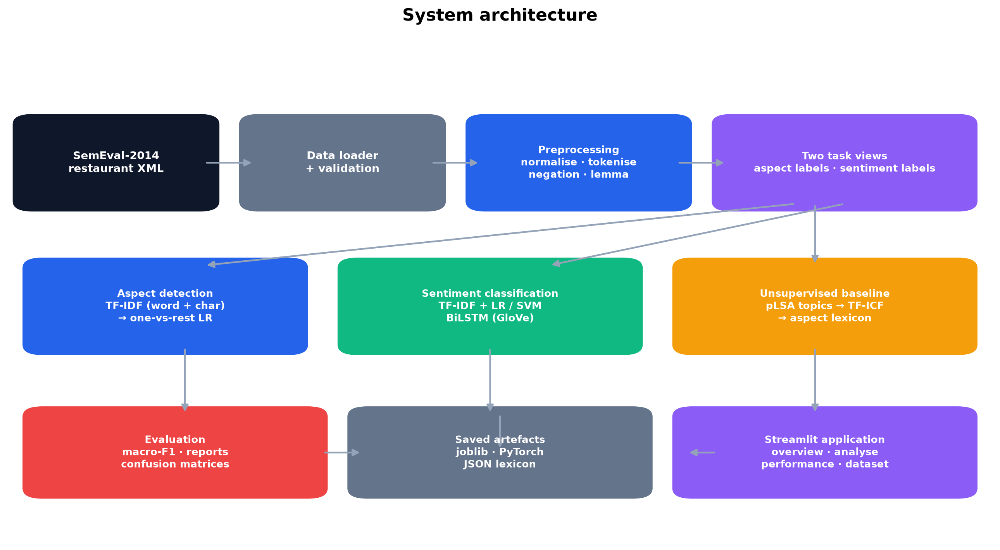
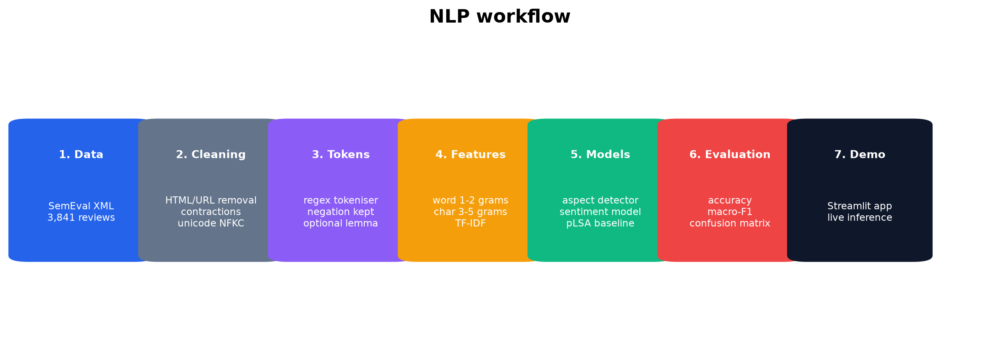
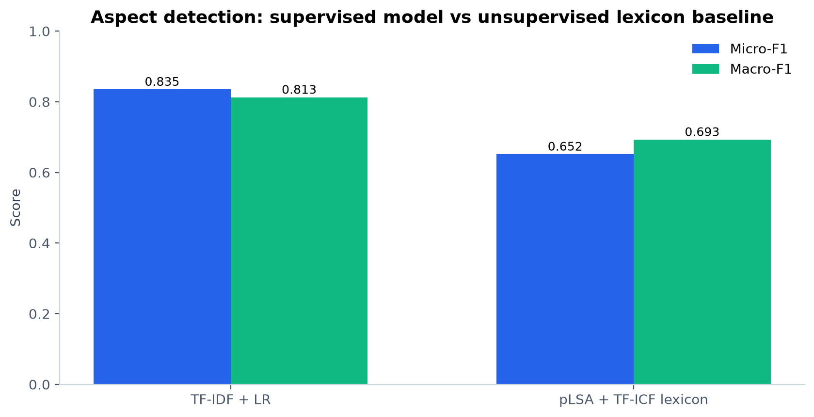
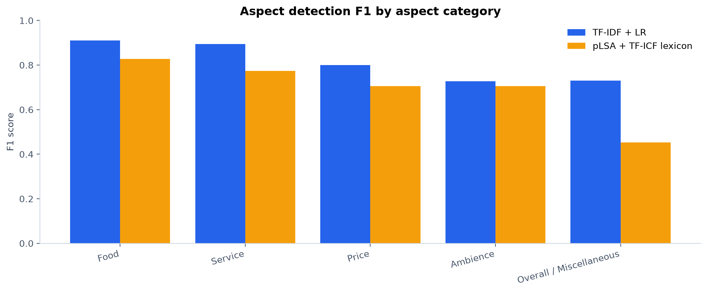
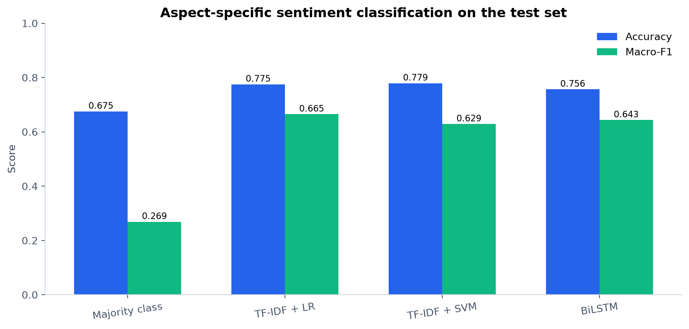
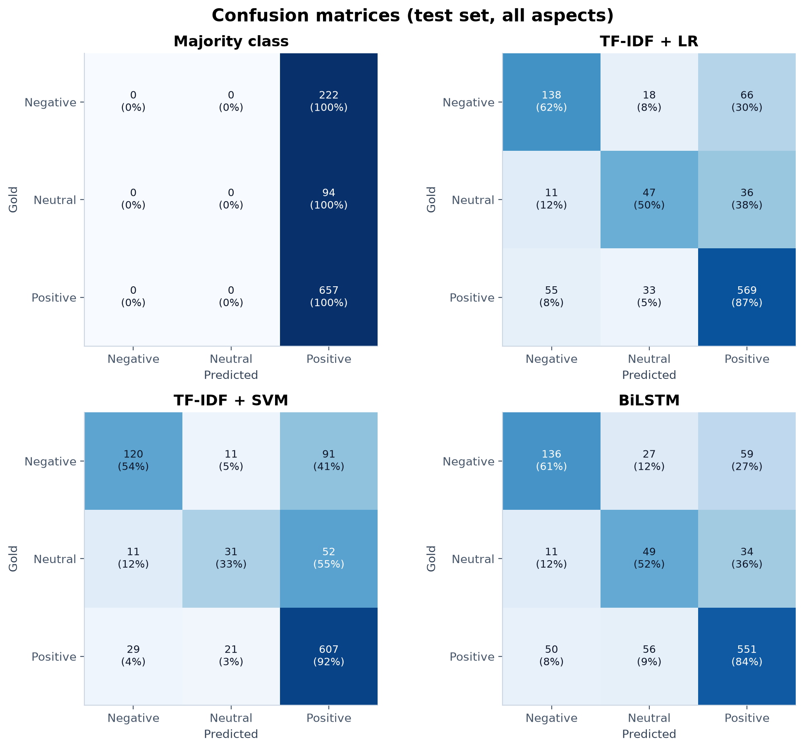
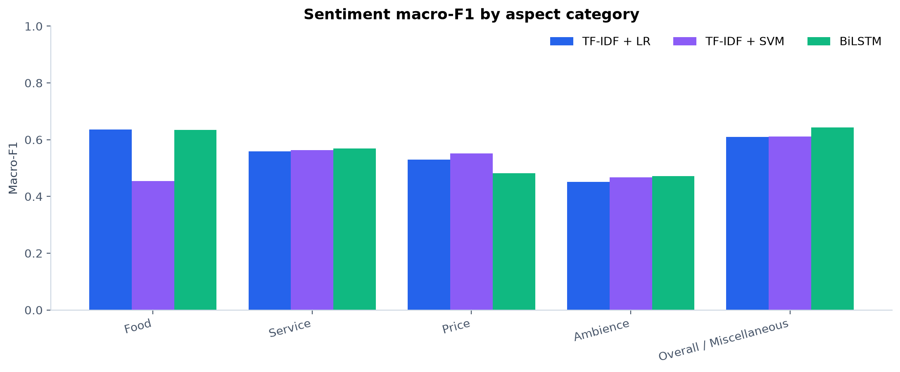
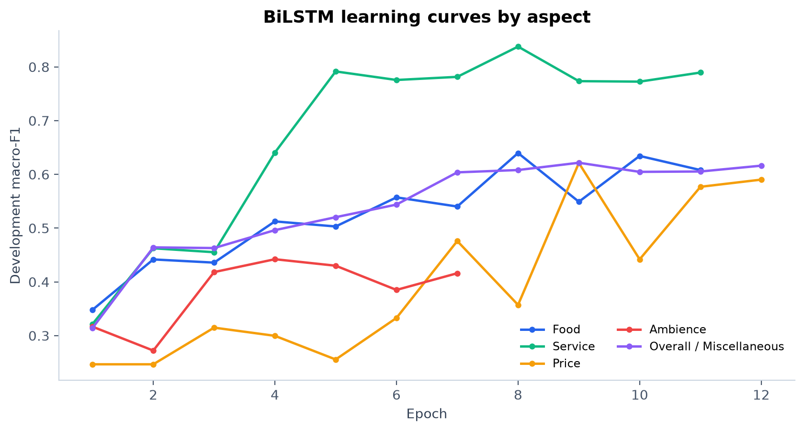

# Aspect-Based Sentiment Analysis of Restaurant Reviews

**A reproducible study with pLSA + TF-ICF, TF-IDF classifiers and a GloVe-initialised BiLSTM**

| | |
|---|---|
| **Project type** | Natural Language Processing coursework |
| **Domain** | Restaurant reviews |
| **Dataset** | SemEval-2014 Task 4, restaurant domain (Pontiki et al., 2014) |
| **Task** | Multi-label aspect category detection + three-class aspect sentiment classification |
| **Implementation** | Python 3.11, scikit-learn 1.9.1, PyTorch 2.15.0, Streamlit 1.67.0 |
| **Hardware** | Apple M4, 16 GB RAM, CPU only |
| **Date** | November 2026 |

---

## Abstract

Aspect-Based Sentiment Analysis (ABSA) asks not merely whether a review is positive, but *what* the review is positive or negative about. This report presents a complete ABSA system for restaurant reviews built on the SemEval-2014 Task 4 benchmark. The system decomposes the problem into aspect category detection over five categories (`food`, `service`, `price`, `ambience`, `miscellaneous`) and aspect-specific three-class sentiment classification (`negative`, `neutral`, `positive`). It compares an unsupervised pipeline based on Probabilistic Latent Semantic Analysis (pLSA) and Term Frequency–Inverse Cluster Frequency (TF-ICF) lexicon expansion with supervised TF-IDF logistic-regression and linear-SVM classifiers, and with five aspect-specific BiLSTM classifiers initialised from GloVe embeddings.

On the official 800-sentence test set, the supervised aspect detector achieves **micro-F1 0.8351** and **macro-F1 0.8126**, substantially outperforming the unsupervised pLSA + TF-ICF baseline (micro-F1 0.6517, macro-F1 0.6930). For aspect sentiment, TF-IDF + logistic regression obtains the best **macro-F1 of 0.6648** (accuracy 0.7749), compared with 0.6287 for a calibrated linear SVM, 0.6433 for the BiLSTM and 0.2687 for a majority-class baseline. The results show that, at this dataset size, carefully tuned classical models remain strong, while the neural model is competitive but data-limited. All models, predictions, figures and tests are included in a reproducible repository with an interactive Streamlit demonstration.

**Keywords:** aspect-based sentiment analysis, SemEval-2014, pLSA, TF-ICF, TF-IDF, logistic regression, BiLSTM, GloVe, Streamlit

---

## 1. Introduction

### 1.1 Problem statement

Online restaurant reviews contain rich, multi-dimensional opinions. A single visit can combine excellent food, rude service, unfair prices and a pleasant atmosphere. Review-level sentiment classification compresses all of this into one label and therefore loses the information that a restaurant owner needs in order to act.

ABSA addresses this limitation by linking sentiment to aspects. Formally, given a review sentence \(s\), the system should:

1. **Detect aspect categories** \(A(s) \subseteq \{\text{food}, \text{service}, \text{price}, \text{ambience}, \text{miscellaneous}\}\); and
2. **Predict a polarity** \(y(s,a) \in \{\text{negative}, \text{neutral}, \text{positive}\}\) for each detected aspect \(a \in A(s)\).

For example:

> “The pasta was absolutely delicious and the staff were friendly, but the music was too loud and the prices are a bit high.”

The desired output is `food → positive`, `service → positive`, `price → negative`, `ambience → negative`. The sentence is simultaneously positive and negative, which no single-label classifier can represent.

### 1.2 Motivation for the selected project

This project was selected for four reasons.

* **Conceptual depth.** ABSA combines multi-label classification, highly imbalanced three-class classification, distributional semantics, topic modelling, sequence modelling and error analysis in one coherent task.
* **Standard benchmark.** SemEval-2014 Task 4 provides an official training/test split with human annotations, enabling honest comparison rather than evaluation on self-labelled data.
* **Practical relevance.** Aspect-level feedback is directly useful for restaurant management, review summarisation and recommendation.
* **Feasibility.** The dataset is small enough to train several model families on a CPU, yet rich enough to support a meaningful empirical comparison.

The project also builds on the open-source repository `wiqilee/absa-plsa-tficf-lstm`, replacing its incomplete hotel-specific prototype with a validated five-aspect restaurant pipeline and a reproducible evaluation.

### 1.3 Objectives

1. Build an end-to-end ABSA pipeline: data preparation, preprocessing, feature extraction, aspect detection, sentiment classification, evaluation and inference.
2. Implement and compare an interpretable pLSA + TF-ICF approach with supervised classical models and a neural model.
3. Evaluate both sub-tasks with standard metrics on the official test split, without test-set leakage.
4. Package the trained system in a polished Streamlit application that uses real models.
5. Provide reproducible scripts, automated tests and honest documentation of limitations.

### 1.4 Contributions

* A clean, validated conversion of the official SemEval XML into sentence-level multi-label and aspect–sentiment views, with integrity checks.
* A from-scratch, dependency-light pLSA implementation and a TF-ICF lexicon-induction pipeline.
* A systematic comparison of unsupervised, classical supervised and neural ABSA models under one evaluation protocol.
* A tested inference engine and six-page Streamlit application with no hard-coded predictions.
* A reproducible artefact set: 19 passing tests, 12 figures, prediction files, confusion matrices and error analyses.

---

## 2. Background and related work

### 2.1 Aspect-based sentiment analysis

SemEval-2014 Task 4 (Pontiki et al., 2014) defined ABSA around aspect terms and aspect categories. The category task asks for a (category, polarity) pair, e.g. `(food, positive)`. The restaurant domain contains the five categories used here; the original `anecdotes/miscellaneous` category is mapped to `miscellaneous`.

Aspect categories are coarser than aspect terms: “the truffle pasta was divine” has the term *truffle pasta* and the category *food*. This project solves the category-level task, not span extraction.

### 2.2 Classical ABSA

Classical approaches rely on lexical resources, n-gram features and linear classifiers. TF-IDF with word and character n-grams is a strong baseline for short reviews because sentiment is often local (“not good”, “great food”) and character n-grams absorb spelling variation. Logistic regression provides calibrated probabilities and interpretable coefficients; linear SVMs are strong in high-dimensional sparse feature spaces.

### 2.3 Probabilistic Latent Semantic Analysis

pLSA (Hofmann, 1999) models a document as a mixture of latent topics and a topic as a distribution over words. With observed documents \(d\) and words \(w\), the model estimates \(P(w \mid z)\) and \(P(z \mid d)\) by Expectation–Maximisation. The E-step computes the posterior topic responsibility of each observed word:

\[
P(z \mid d,w) = \frac{P(w \mid z)\,P(z \mid d)}{\sum_{z'} P(w \mid z')\,P(z' \mid d)}
\]

The M-step re-estimates the word and document distributions from the expected counts. pLSA is attractive here because it is transparent, fast on a few thousand short documents and does not require labels.

### 2.4 TF-ICF

TF-ICF (Term Frequency–Inverse Cluster Frequency) reweights terms by how specific they are to a cluster:

\[
\mathrm{tf\text{-}icf}(t,c) = \mathrm{tf}(t,c)\cdot \log\frac{N}{\mathrm{cf}(t)}
\]

where \(N\) is the number of clusters and \(\mathrm{cf}(t)\) is the number of clusters containing term \(t\). Terms frequent in one pLSA cluster but rare elsewhere receive high scores. This is the mechanism used to expand the seed aspect lexicons with corpus-specific vocabulary.

### 2.5 Neural sequence models

BiLSTMs (Hochreiter & Schmidhuber, 1997) model word order and long-range dependencies. Pre-trained word embeddings such as GloVe (Pennington et al., 2014) provide distributional priors for small datasets. A common architecture embeds the sentence, runs a bidirectional LSTM, pools the hidden states and applies a softmax classifier. This project uses masked mean and max pooling, dropout, class weighting and early stopping.

### 2.6 Positioning

The project is deliberately comparative. The unsupervised pLSA + TF-ICF pipeline demonstrates what can be learned without labels and provides an interpretable view of the corpus. The supervised TF-IDF models represent a strong, reproducible baseline. The BiLSTM tests whether neural sequence modelling improves on that baseline at the available data scale. Reporting all three, including cases where the neural model loses, is part of the contribution.

---

## 3. Dataset

### 3.1 Source

The data is the official **SemEval-2014 Task 4 restaurant** release:

* `Restaurants_Train_v2.xml` — 3,041 annotated sentences.
* `Restaurants_Test_Gold.xml` — 800 annotated gold test sentences.

The XML was obtained from the public mirror `alexcadillon/SemEval2014Task4` on Hugging Face, which reproduces the official ACL Anthology release. The dataset is used for research and coursework; the original files are retained under `data/raw/semeval2014/`.

### 3.2 Preprocessing of annotations

`src/data_loader.py` parses each `<sentence>` and produces two views:

1. **Sentence-level view** — one row per sentence, with binary columns for each aspect.
2. **Aspect–sentiment view** — one row per (sentence, aspect) pair with polarity.

The `conflict` polarity is excluded from the three-class task because it does not represent a coherent polarity class. Six exact duplicate training texts are removed (the first annotation is kept). The official test split is left untouched.

### 3.3 Label space

* **Aspects:** `food`, `service`, `price`, `ambience`, `miscellaneous`.
* **Sentiment:** `negative` (0), `neutral` (1), `positive` (2).

### 3.4 Descriptive statistics

| Statistic | Train | Test |
|---|---:|---:|
| Sentences | 3,041 | 800 |
| Empty texts | 0 | 0 |
| Duplicate texts (before cleaning) | 6 | 0 |
| Aspect-category annotations | 3,713 | 1,025 |
| Aspect-term annotations | 3,693 | 1,134 |
| Aspect–sentiment rows after cleaning | 3,511 | 973 |
| Mean tokens per sentence | 13.83 | 14.03 |
| Maximum tokens | 69 | 58 |
| Sentences with ≥2 aspects | 574 | 189 |

Polarity distribution over aspect categories:

| Polarity | Train | Test |
|---|---:|---:|
| Positive | 2,179 | 657 |
| Negative | 839 | 222 |
| Neutral | 500 | 94 |
| Conflict (excluded) | 195 | 52 |

Aspect distribution:

| Aspect | Train annotations | Test annotations | Test sentiment rows |
|---|---:|---:|---:|
| Food | 1,232 | 418 | 402 |
| Service | 597 | 172 | 167 |
| Price | 321 | 83 | 80 |
| Ambience | 431 | 118 | 105 |
| Miscellaneous | 1,132 | 234 | 219 |
| **Total** | **3,713** | **1,025** | **973** |

### 3.5 Class imbalance

Positive sentiment dominates (67.5% of test rows), while neutral is rare (9.7%). This has two consequences. First, accuracy alone is misleading: a majority-class predictor reaches 0.6752 accuracy but only 0.2687 macro-F1. Second, macro-F1 is used as the primary model-selection metric because it weights all three classes equally. Balanced class weights are used in all supervised sentiment models.

### 3.6 Leakage prevention

The official training split is used for fitting. A 15% development split (456 sentences) is carved out of training for:

* selection of the logistic-regression regularisation strength `C`;
* per-aspect aspect-detection thresholds;
* BiLSTM early stopping and epoch selection.

The official test split is used only once, for final reporting. Vectorisers are fitted on training text only and applied to dev/test text.

---

## 4. Methodology

### 4.1 Overview



*Figure 1. System architecture. Raw reviews pass through preprocessing into two parallel branches: an unsupervised pLSA + TF-ICF branch and a supervised TF-IDF branch. Aspect detection is followed by aspect-specific sentiment classification.*



*Figure 2. End-to-end workflow from data preparation to the Streamlit demonstration.*

### 4.2 Text preprocessing

`src/preprocessing.py` applies:

| Technique | Applied | Rationale |
|---|---|---|
| Unicode NFKC normalisation | Yes | Canonicalises ligatures and full-width characters. |
| HTML / URL removal | Yes | Web-scraped reviews contain markup. |
| Contraction expansion | Yes | Preserves negation: `wasn't` → `was not`. |
| Lowercasing | Yes | Reduces vocabulary sparsity. |
| Punctuation handling | Partial | Punctuation is dropped, but `!` becomes an emphasis token. |
| Regex tokenisation | Yes | Keeps apostrophes and negators. |
| Stop-word removal | Only pLSA | Removes topical noise; supervised models keep negators and intensifiers. |
| Lemmatisation | Only pLSA | Groups inflections for topic discovery; avoids harming GloVe alignment. |
| Duplicate removal | Training only | Six exact duplicates removed; test kept intact. |

The design choice to keep stop-words for supervised models is deliberate: removing “not”, “no” or “never” would destroy sentiment cues.

### 4.3 Feature extraction

Supervised models use a `FeatureUnion` of:

* **Word TF-IDF**, 1–2 grams, sublinear term frequency.
* **Character TF-IDF**, 3–5 grams with `char_wb`, up to 60,000 features.

Word n-grams capture local sentiment and negation; character n-grams capture morphology and spelling variation (“delicious”, “deliciously”, “delish”). All vectorisers use `min_df=2` and are fitted on training text only.

### 4.4 pLSA

`src/plsa.py` implements pLSA with sparse matrix operations. The training corpus is tokenised with stop-word removal and lemmatisation, then represented as a document–term count matrix (minimum document frequency 3, maximum 3,000 vocabulary items). The model uses 20 topics and 30 EM iterations with a fixed random seed.

The E-step computes topic responsibilities for each observed word; the M-step accumulates expected counts and renormalises \(P(w \mid z)\) and \(P(z \mid d)\). The observed-data log-likelihood is recorded for monitoring. New documents are projected by fold-in with fixed \(P(w \mid z)\).

### 4.5 TF-ICF and lexicon induction

Documents are hard-assigned to the topic with the highest \(P(z \mid d)\). For each cluster, TF-ICF scores terms by presence-based term frequency and inverse cluster frequency. The top 30 terms per topic are retained.

Each aspect has a small seed lexicon in `src/config.py`. The seed vector and each topic’s normalised \(P(w \mid z)\) vector are compared by cosine similarity. Top TF-ICF terms from positively aligned topics are transferred into the aspect lexicon, weighted by similarity, up to 60 expanded terms per aspect. This yields an interpretable, label-free aspect lexicon and a weighted-hit baseline detector.

### 4.6 Supervised aspect detection

A one-vs-rest logistic regression is trained on the word + character TF-IDF union with balanced class weights. The regularisation strength is selected from \(C \in \{1, 4, 10\}\) on the development split. One probability threshold per aspect is then tuned on dev data by maximising per-aspect F1 over a grid from 0.10 to 0.90.

Selected thresholds:

| Aspect | Threshold |
|---|---:|
| Food | 0.40 |
| Service | 0.50 |
| Price | 0.30 |
| Ambience | 0.65 |
| Miscellaneous | 0.35 |

The final detector is refitted on the full training split with the selected `C = 4.0`.

### 4.7 Sentiment classifiers

Three classifiers are trained per aspect.

**TF-IDF + Logistic Regression.** Balanced class weights, L2 regularisation, `lbfgs`, up to 3,000 iterations. `C` is tuned per aspect on a stratified 15% dev split. Selected values: food 4.0; service, price, ambience and miscellaneous 1.0.

**TF-IDF + Calibrated Linear SVM.** `LinearSVC` with balanced class weights and sigmoid calibration over three folds. This is a comparison model; its hyper-parameter is fixed at `C = 1.0`.

**GloVe-initialised BiLSTM.** Each aspect gets its own classifier. The shared vocabulary contains 4,120 tokens; GloVe 6B 50-d covers 92.38% of it. The architecture is:

```text
Embedding (50-d, GloVe-initialised, fine-tuned)
  → BiLSTM (96 units per direction)
  → masked mean pooling ⊕ masked max pooling
  → Dropout (0.35)
  → Dense (128, ReLU)
  → Dropout (0.35)
  → Softmax (3 classes)
```

Training uses class-weighted cross-entropy, Adam with learning rate \(10^{-3}\), gradient clipping at 5.0 and `ReduceLROnPlateau`. Early stopping monitors dev macro-F1 with patience 3. After the best epoch is identified, the model is refitted on the full aspect subset for that many epochs at half the learning rate, recovering the 15% held-out data without changing the selected epoch count.

Selected epochs and dev macro-F1:

| Aspect | Best epoch | Dev macro-F1 | Training rows | Dev rows |
|---|---:|---:|---:|---:|
| Food | 8 | 0.6397 | 989 | 175 |
| Service | 8 | 0.8378 | 476 | 85 |
| Price | 9 | 0.6212 | 258 | 46 |
| Ambience | 4 | 0.4421 | 326 | 58 |
| Miscellaneous | 9 | 0.6216 | 933 | 165 |

### 4.8 Inference and aggregation

`src/predict.py` exposes `AspectSentimentEngine`. It loads the saved aspect detector, sentiment bundles and five BiLSTM checkpoints, validates input (minimum two tokens), computes aspect probabilities, applies tuned thresholds (optionally with a stricter user floor), predicts sentiment for each selected aspect, and computes a weighted overall verdict for display. The overall verdict is explicitly a display summary, not a separately trained classifier.

---

## 5. Experimental setup

### 5.1 Implementation and environment

* Python 3.11.17 on macOS (Apple M4, 16 GB RAM), CPU only.
* scikit-learn 1.9.1, NumPy 2.4.6, pandas 3.1.1.
* PyTorch 2.15.0.
* Streamlit 1.67.0, Altair 6.3.0.
* NLTK 3.10.4 for stop-words and WordNet lemmatisation.
* Matplotlib 3.11.2 for figures.
* pytest 9.2.0.

Full training of all components takes approximately 48 seconds on this machine once GloVe is present. Evaluation, figure generation and tests take a few seconds each.

### 5.2 Metrics

**Aspect detection (multi-label):**

* Micro-F1, macro-F1 and weighted-F1.
* Hamming loss (fraction of incorrect aspect labels).
* Subset accuracy (exact match of the full aspect set).
* Per-aspect precision, recall, F1 and ROC-AUC.

**Sentiment classification:**

* Accuracy, macro-F1 and weighted-F1.
* Per-class precision, recall and F1.
* Confusion matrices.
* Per-aspect macro-F1.

Macro-F1 is the primary sentiment metric because of class imbalance.

### 5.3 Baselines

* **Majority class per aspect** for sentiment (lower bound).
* **Unsupervised pLSA + TF-ICF weighted lexicon** for aspect detection.
* **TF-IDF + calibrated linear SVM** as a second classical sentiment model.
* **BiLSTM** as the neural model.

### 5.4 Reproducibility

All random operations use seed 42: train/dev splitting, classical models and PyTorch initialisation. Artefacts are written deterministically to `models/` and `outputs/`. The pipeline can be reproduced with:

```bash
python -m scripts.prepare_data
python -m scripts.train_all
python -m scripts.evaluate_all
python -m scripts.generate_figures
pytest -q
```

---

## 6. Results

All results below are computed on the official SemEval-2014 test split (800 sentences, 973 aspect–sentiment rows) and are stored in `outputs/reports/metrics.json`.

### 6.1 Aspect category detection

| Model | Micro-F1 | Macro-F1 | Weighted-F1 | Hamming loss ↓ | Subset accuracy |
|---|---:|---:|---:|---:|---:|
| **Supervised TF-IDF + one-vs-rest LR** | **0.8351** | **0.8126** | **0.8367** | **0.0860** | **0.6875** |
| Unsupervised pLSA + TF-ICF lexicon | 0.6517 | 0.6930 | 0.7091 | 0.2245 | 0.2038 |

Per-aspect performance:

| Aspect | Supervised P | Supervised R | Supervised F1 | Supervised AUC | Lexicon F1 |
|---|---:|---:|---:|---:|---:|
| Food | 0.9093 | 0.9115 | **0.9104** | 0.9650 | 0.8278 |
| Service | 0.9000 | 0.8895 | **0.8947** | 0.9801 | 0.7734 |
| Price | 0.7609 | 0.8434 | **0.8000** | 0.9719 | 0.7051 |
| Ambience | 0.8352 | 0.6441 | **0.7273** | 0.9361 | 0.7059 |
| Miscellaneous | 0.6609 | 0.8162 | **0.7304** | 0.9042 | 0.4526 |



*Figure 3. Supervised versus unsupervised aspect detection.*



*Figure 4. Per-aspect detection quality.*

The supervised detector is stronger on every aggregate metric. The largest gap is on `miscellaneous`: the lexicon baseline has perfect recall but very low precision (0.2925), because broad seed terms such as “restaurant”, “place”, “good” and “bad” fire on almost every review. The supervised model learns when those words actually indicate an overall judgement.

Ambience is the hardest supervised aspect to detect, with recall 0.6441. Ambience cues are often implicit (“we could barely hear each other”, “we sat outside”) and overlap with service and miscellaneous language.

### 6.2 Sentiment classification

| Model | Accuracy | Macro-F1 | Weighted-F1 | N |
|---|---:|---:|---:|---:|
| **TF-IDF + Logistic Regression** | 0.7749 | **0.6648** | **0.7737** | 973 |
| TF-IDF + calibrated Linear SVM | **0.7790** | 0.6287 | 0.7641 | 973 |
| BiLSTM (GloVe-initialised) | 0.7564 | 0.6433 | 0.7620 | 973 |
| Majority class | 0.6752 | 0.2687 | 0.5443 | 973 |



*Figure 5. Sentiment model comparison. Macro-F1 is the primary metric.*

Per-class results:

| Model | Class | Precision | Recall | F1 | Support |
|---|---|---:|---:|---:|---:|
| LR | Negative | 0.6765 | 0.6216 | 0.6479 | 222 |
| LR | Neutral | 0.4796 | 0.5000 | 0.4896 | 94 |
| LR | Positive | 0.8480 | 0.8661 | 0.8569 | 657 |
| SVM | Negative | 0.7500 | 0.5405 | 0.6283 | 222 |
| SVM | Neutral | 0.4921 | 0.3298 | 0.3949 | 94 |
| SVM | Positive | 0.8093 | 0.9239 | 0.8628 | 657 |
| BiLSTM | Negative | 0.6904 | 0.6126 | 0.6492 | 222 |
| BiLSTM | Neutral | 0.3712 | 0.5213 | 0.4336 | 94 |
| BiLSTM | Positive | 0.8556 | 0.8387 | 0.8470 | 657 |

Confusion matrices (rows: true negative / neutral / positive; columns: predicted negative / neutral / positive):

| Model | Matrix |
|---|---|
| Majority | `[[0, 0, 222], [0, 0, 94], [0, 0, 657]]` |
| LR | `[[138, 18, 66], [11, 47, 36], [55, 33, 569]]` |
| SVM | `[[120, 11, 91], [11, 31, 52], [29, 21, 607]]` |
| BiLSTM | `[[136, 27, 59], [11, 49, 34], [50, 56, 551]]` |



*Figure 6. Confusion matrices for the sentiment models.*

The logistic regression has the best balance across classes. The SVM is slightly more accurate because it predicts positive more aggressively (recall 0.9239) but loses neutral performance (F1 0.3949). The BiLSTM predicts neutral more often than the SVM (recall 0.5213) but with low precision (0.3712), producing many false neutral predictions for positive examples.

### 6.3 Per-aspect sentiment

| Aspect | LR macro-F1 | BiLSTM macro-F1 | N |
|---|---:|---:|---:|
| Food | 0.6359 | 0.6349 | 402 |
| Service | 0.5591 | **0.5694** | 167 |
| Price | **0.5294** | 0.4819 | 80 |
| Ambience | 0.4517 | **0.4714** | 105 |
| Miscellaneous | 0.6093 | **0.6436** | 219 |



*Figure 7. Per-aspect sentiment macro-F1.*

The BiLSTM is slightly better on service, ambience and miscellaneous, but worse on food and price. With only 80 test rows for price, differences of a few points are noisy. The overall advantage of LR comes from better calibration and more consistent neutral handling.

### 6.4 BiLSTM training behaviour



*Figure 8. Development macro-F1 by epoch for the five aspect-specific BiLSTMs.*

Training curves show clear overfitting after the selected epoch, especially for food and miscellaneous: training loss continues to fall while dev macro-F1 plateaus or declines. Early stopping and full-subset refitting mitigate this, but the fundamental limitation is data size. The model has roughly 200k parameters and fewer than 1,200 training rows per aspect.

### 6.5 Comparison and discussion

The empirical ranking is consistent and interpretable:

1. **Supervised aspect detection >> unsupervised lexicon baseline.** Labels matter. The lexicon baseline cannot learn pragmatic cues such as “we will be back” indicating an overall positive judgement, whereas the supervised model learns them from 3,035 sentences. The gap is 18.3 micro-F1 points.
2. **TF-IDF + LR > SVM on macro-F1.** The SVM's aggressive positive bias improves accuracy but hurts the rare neutral class. LR's calibrated probabilities and balanced weights produce a better three-class trade-off.
3. **TF-IDF + LR > BiLSTM on macro-F1.** With ~3.5k aspect–sentiment rows and 50-d embeddings, the neural model does not have enough data to outperform a strong sparse linear baseline. The BiLSTM is competitive (0.6433 vs. 0.6648) and wins on three of five aspects, but its errors are more confident.
4. **All supervised models >> majority baseline.** Macro-F1 rises from 0.2687 to 0.6648, demonstrating that the models learn genuine sentiment signals rather than relying on the positive prior.

### 6.6 Error analysis

The 50 most confident BiLSTM errors are stored in `outputs/reports/error_analysis.csv`. Three patterns dominate.

**(a) Neutral is confused with positive.** Neutral annotations often describe factual or mildly positive content:

> “I was on jury duty, rode my bike up Centre Street on my lunch break and came across this great little place with awesome chicken tacos and Hibiscus lemonade.”
> Gold: `miscellaneous/neutral`; BiLSTM: `positive` (0.999999).

The sentence contains positive words (“great”, “awesome”) but the annotators did not treat it as a polarity judgement about the restaurant. This is partly annotation ambiguity and partly a limitation of sentence-level classification.

**(b) Negation and conditionals.** The BiLSTM is overconfident on some negated statements:

> “I would not recommend MEET at all, it is a rip off all the way from the time to step in!”
> Gold: `miscellaneous/negative`; BiLSTM: `positive` (0.999906).

The default logistic-regression model handles the shorter variant “I would not recommend this place at all.” correctly (`miscellaneous/negative`, confidence 0.554), showing the value of word n-grams that explicitly encode “not recommend”.

**(c) Aspect leakage.** A sentiment cue for one aspect can dominate another aspect’s prediction:

> “The service, however, is a peg or two below the quality of food (horrible bartenders), and the clientele, for the most part, are rowdy, loud-mouthed commuters...”
> Gold: `food/positive`; BiLSTM: `negative` (0.999442).

The sentence is positive about food but negative about service and atmosphere. The aspect-specific classifiers see the whole sentence, so negative cues can overwhelm the target aspect. This is the central open problem in ABSA without explicit aspect-term masking or attention.

### 6.7 Qualitative demonstration

The default application configuration (supervised aspect detection + TF-IDF logistic regression) on the multi-aspect example produces:

| Aspect | Aspect probability | Sentiment | Confidence |
|---|---:|---|---:|
| Food | 0.718 | positive | 0.895 |
| Service | 0.847 | positive | 0.777 |
| Price | 0.710 | negative | 0.531 |
| Ambience | 0.658 | negative | 0.609 |

Overall weighted verdict: **positive (0.602)**, correctly reflecting that the positive aspects carry more probability mass while still exposing the complaints.

A second example, “The sushi was fresh and tasty, though the bill was surprisingly expensive.”, yields `food → positive (0.704)` and `price → negative (0.748)`.

---

## 7. Discussion

### 7.1 Why the unsupervised baseline loses

The pLSA + TF-ICF pipeline discovers coherent topics, but topic clusters do not align one-to-one with aspect categories. A topic may mix food and price language (“menu”, “price”, “dish”), and the broad miscellaneous seed lexicon fires on nearly every review. Threshold tuning improves precision but cannot recover semantic cues that are absent from the lexicon. This is a fundamental limitation of lexicon-based ABSA, not an implementation bug.

### 7.2 Why the BiLSTM does not win

Three factors explain the result:

* **Data size.** Roughly 3.5k aspect–sentiment rows, split across five aspects, are insufficient for a 200k-parameter model to generalise better than a sparse linear model.
* **Embedding quality.** GloVe 6B 50-d is small. The vocabulary coverage is high (92.38%), but 50 dimensions limit the representation of nuanced sentiment.
* **Aspect focus.** The BiLSTM reads the whole sentence for every aspect. Without attention or aspect-term masking, it cannot reliably focus on the relevant clause. TF-IDF has the same limitation, but its lower capacity and n-gram weighting make it less prone to confident leakage.

A transformer fine-tuned on more data or with aspect-aware attention would be the natural next step, but that is outside the CPU-only scope of this project.

### 7.3 The neutral class

Neutral is rare and semantically fuzzy. Annotators use it for factual statements, mild opinions and mixed cases. Both classical and neural models struggle. Macro-F1 is therefore the right primary metric, and the confusion matrices should be read alongside accuracy.

### 7.4 Aspect leakage and negation

The error analysis shows that sentence-level ABSA without span information is fundamentally limited. Future work should incorporate aspect-term spans, dependency parses or attention over aspect-specific context. Negation handling could be improved with explicit negation scopes or contrastive data augmentation.

---

## 8. Limitations

* **Category-level, not span-level.** The system does not extract opinion targets or aspect terms.
* **English restaurant domain only.** Performance on hotels, electronics or other languages is not established.
* **Neutral class.** Rare and ambiguous; macro-F1 is much lower than accuracy.
* **BiLSTM data efficiency.** The neural model is competitive but not superior at this data scale.
* **Aspect leakage.** Whole-sentence classifiers can confuse polarities across aspects.
* **Pragmatics.** Sarcasm, conditionals and long-range negation remain difficult.
* **Lexicon baseline.** pLSA + TF-ICF is interpretable but weak; it is a comparison baseline, not the production detector.
* **Annotation ambiguity.** The excluded `conflict` label and subjective sentences create irreducible errors.

---

## 9. Ethics and responsible use

The system analyses public restaurant reviews and predicts sentiment. It should be used as decision support, not as an automated judge of businesses or employees. Predictions can be wrong, especially for neutral, sarcastic or multi-aspect text. The application displays confidence scores and an error-analysis page so that users can see failure modes. No personal data is collected, and no external API is called at inference time.

---

## 10. Future work

1. **Aspect-term extraction** with BIO tagging or span-based models.
2. **Transformer fine-tuning** (e.g. RoBERTa) with GPU resources.
3. **Aspect-aware attention** or aspect-term masking to reduce leakage.
4. **Multi-domain and multilingual evaluation.**
5. **Ordinal modelling** of polarity and better confidence calibration.
6. **Active learning** to reduce annotation cost.
7. **Review-level aggregation** with learned weights rather than display-only weighting.

---

## 11. Conclusion

This project delivered a complete, reproducible ABSA system for restaurant reviews. It parsed the official SemEval-2014 dataset, implemented pLSA and TF-ICF from scratch, trained supervised TF-IDF and neural classifiers, evaluated both sub-tasks on the official test split, and packaged the result in a tested Streamlit application.

The main empirical findings are that supervised aspect detection is far stronger than an unsupervised lexicon baseline (micro-F1 0.8351 vs. 0.6517), and that TF-IDF + logistic regression remains the best sentiment model at this data scale (macro-F1 0.6648 vs. 0.6433 for the BiLSTM). The neural model is competitive and wins on three of five aspects, but its confident errors on negation and aspect leakage illustrate the limits of whole-sentence classification without aspect-aware context. These results are reported honestly, with error analysis and limitations, and the entire pipeline can be reproduced with five commands.

---

## References

1. Pontiki, M., Galanis, D., Pavlopoulos, J., Papageorgiou, H., Androutsopoulos, I., & Manandhar, S. (2014). *SemEval-2014 Task 4: Aspect Based Sentiment Analysis.* Proceedings of the 8th International Workshop on Semantic Evaluation (SemEval 2014), pp. 27–35. <https://aclanthology.org/S14-2004>
2. Hofmann, T. (1999). *Probabilistic Latent Semantic Analysis.* Proceedings of the 15th Conference on Uncertainty in Artificial Intelligence (UAI 1999).
3. Pennington, J., Socher, R., & Manning, C. D. (2014). *GloVe: Global Vectors for Word Representation.* Proceedings of EMNLP 2014.
4. Hochreiter, S., & Schmidhuber, J. (1997). *Long Short-Term Memory.* Neural Computation, 9(8), 1735–1780.
5. Joachims, T. (1998). *Text Categorization with Support Vector Machines: Learning with Many Relevant Features.* ECML 1998.
6. Blei, D. M., Ng, A. Y., & Jordan, M. I. (2003). *Latent Dirichlet Allocation.* Journal of Machine Learning Research, 3, 993–1022.
7. Pedregosa, F., et al. (2011). *Scikit-learn: Machine Learning in Python.* Journal of Machine Learning Research, 12, 2825–2830.
8. Paszke, A., et al. (2019). *PyTorch: An Imperative Style, High-Performance Deep Learning Library.* NeurIPS 2019.
9. Original repository: `wiqilee/absa-plsa-tficf-lstm` (MIT licence).

---

## Appendix A — Reproduction commands

```bash
python3.11 -m venv .venv
source .venv/bin/activate
pip install -r requirements.txt
python -m scripts.download_assets
python -m scripts.prepare_data
python -m scripts.train_all
python -m scripts.evaluate_all
python -m scripts.generate_figures
pytest -q
streamlit run app.py
```

## Appendix B — Artefacts

| Path | Contents |
|---|---|
| `models/aspect_detector.joblib` | TF-IDF union + one-vs-rest LR + thresholds |
| `models/sentiment_models.joblib` | Per-aspect TF-IDF + LR bundle |
| `models/sentiment_svm.joblib` | Per-aspect calibrated linear SVM bundle |
| `models/lstm/{aspect}.pt` | Five BiLSTM checkpoints + vocabularies |
| `models/plsa_model.joblib` | Fitted pLSA model |
| `models/aspect_lexicon.json` | Induced lexicon, topics and baseline thresholds |
| `outputs/reports/metrics.json` | Authoritative test metrics |
| `outputs/reports/test_aspect_predictions.csv` | Sentence-level aspect predictions |
| `outputs/reports/test_sentiment_predictions.csv` | Aspect-level sentiment predictions |
| `outputs/reports/classification_report.txt` | Per-class report for the best model |
| `outputs/reports/error_analysis.csv` | Most confident BiLSTM errors |
| `outputs/figures/` | 12 report and application figures |

## Appendix C — Test coverage

`tests/test_pipeline.py` contains 19 tests covering:

* XML parsing and dataset integrity (3,041 train / 800 test sentences).
* Processed frame schemas, label spaces and row counts.
* Frame builders for sentence-level and aspect–sentiment views.
* Preprocessing: negation preservation, URL/HTML removal, emphasis tokens.
* pLSA training, normalisation and fold-in inference.
* TF-ICF cluster specificity.
* TF-IDF vectoriser round-trip and writable sparse matrices.
* Lexicon detector scoring and threshold tuning.
* Sentiment and aspect metric implementations.
* Saved artefact presence.
* End-to-end engine predictions with every sentiment model.
* Supervised and lexicon aspect detection.
* Input validation for empty and one-word reviews.
* Metrics JSON validity.
* Streamlit application startup via `streamlit.testing.v1.AppTest`.

Result: **19 passed, 2 warnings** (a scikit-learn ROC-AUC warning on a synthetic single-class test fixture, not a failure).
