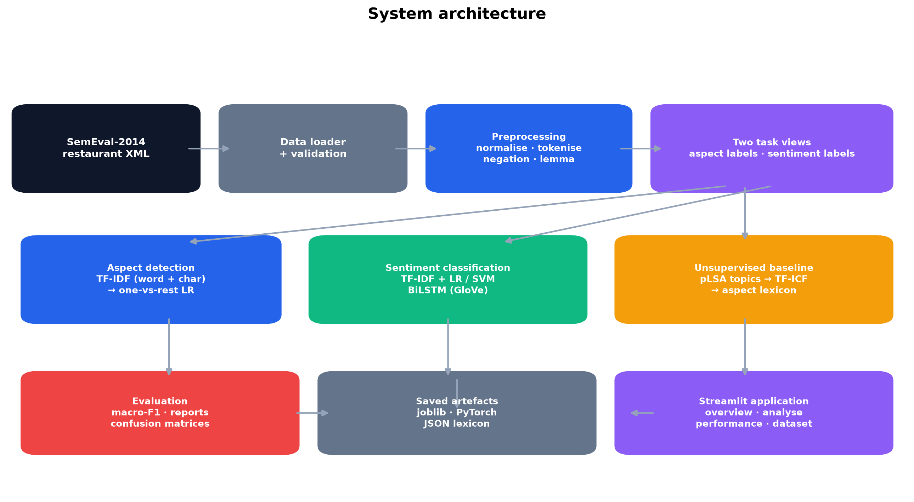
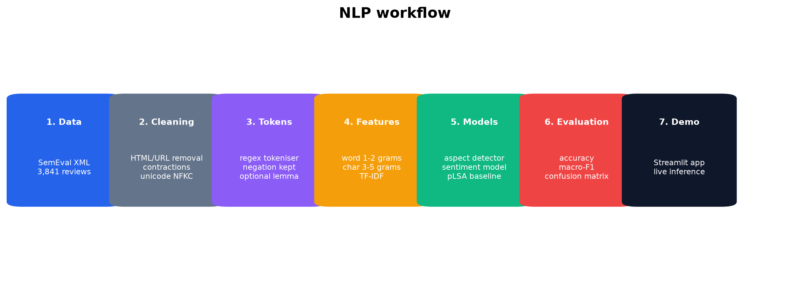
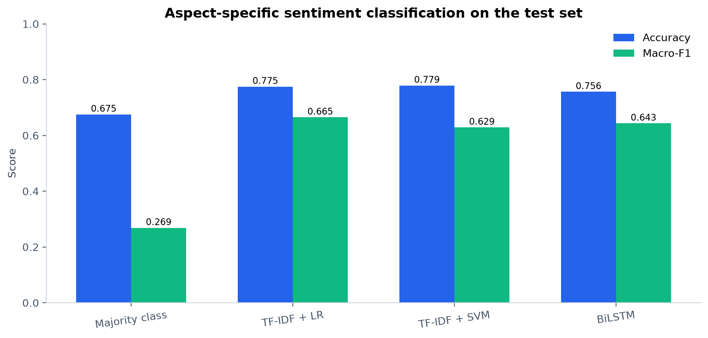

# Aspect-Based Sentiment Analysis of Restaurant Reviews

**SemEval-2014 Task 4 · pLSA + TF-ICF · TF-IDF classifiers · GloVe BiLSTM · Streamlit**

A complete, reproducible Natural Language Processing coursework project that identifies **which aspects of a restaurant a review discusses** and **whether the reviewer is negative, neutral or positive about each one**.

The repository contains the real SemEval-2014 restaurant dataset, trained model artefacts, an evaluation suite, an interactive Streamlit application, automated tests, and this documentation. Every number reported below was produced by the scripts in `scripts/` and stored under `outputs/`.

---

## 1. Problem statement

A single star rating collapses an entire restaurant visit into one number. A review can say:

> “The pasta was absolutely delicious and the staff were friendly, but the music was too loud and the prices are a bit high.”

A review-level classifier might call this “positive” and hide the two concrete complaints. Aspect-Based Sentiment Analysis (ABSA) instead solves two linked tasks:

1. **Aspect category detection** — which of `food`, `service`, `price`, `ambience` and `miscellaneous` are mentioned?
2. **Aspect sentiment classification** — for each detected aspect, is the polarity `negative`, `neutral` or `positive`?

This project implements both tasks end to end, compares a transparent topic-model/lexicon approach with supervised classical models and a neural model, and exposes the result through an interactive demo.

**Why this project was selected:** ABSA is a core NLP problem that combines multi-label classification, imbalanced three-class sentiment classification, distributional semantics, topic modelling, neural sequence modelling and practical model evaluation. It has a standard public benchmark, clear business value, and enough depth to demonstrate both classical and neural NLP techniques on a CPU-only budget.

---

## 2. Key results (official SemEval-2014 test split)

### Aspect category detection

| Model | Micro-F1 | Macro-F1 | Hamming loss ↓ | Subset accuracy |
|---|---:|---:|---:|---:|
| **Supervised TF-IDF + one-vs-rest LR** | **0.8351** | **0.8126** | **0.0860** | **0.6875** |
| Unsupervised pLSA + TF-ICF lexicon | 0.6517 | 0.6930 | 0.2245 | 0.2038 |

### Aspect sentiment classification (973 aspect–sentiment rows)

| Model | Accuracy | Macro-F1 | Weighted-F1 |
|---|---:|---:|---:|
| **TF-IDF + Logistic Regression** | 0.7749 | **0.6648** | **0.7737** |
| TF-IDF + calibrated Linear SVM | **0.7790** | 0.6287 | 0.7641 |
| BiLSTM (GloVe-initialised) | 0.7564 | 0.6433 | 0.7620 |
| Majority-class baseline | 0.6752 | 0.2687 | 0.5443 |

The logistic-regression model has the best **macro-F1**, which is the primary metric because the neutral class is rare. The SVM is marginally more accurate but trades away neutral-class performance. The BiLSTM is competitive but does not beat the classical baselines on this dataset size; this is reported honestly rather than hidden.

### Per-aspect results

**Aspect detection F1 (supervised):** food 0.9104 · service 0.8947 · price 0.8000 · ambience 0.7273 · miscellaneous 0.7304.

**Sentiment macro-F1 (TF-IDF + LR):** food 0.6359 · service 0.5591 · price 0.5294 · ambience 0.4517 · miscellaneous 0.6093.

**Sentiment macro-F1 (BiLSTM):** food 0.6349 · service 0.5694 · price 0.4819 · ambience 0.4714 · miscellaneous 0.6436.

Full per-class reports, confusion matrices, prediction files and error analyses are under `outputs/reports/` and `outputs/tables/`. Figures are under `outputs/figures/`.

---

## 3. Dataset

**SemEval-2014 Task 4: Aspect Based Sentiment Analysis — restaurant domain** (Pontiki et al., 2014).

* ACL Anthology: <https://aclanthology.org/S14-2004>
* Official task page: <https://alt.qcri.org/semeval2014/task4/>
* Public mirror used for download: <https://huggingface.co/datasets/alexcadillon/SemEval2014Task4>

| Statistic | Train | Test |
|---|---:|---:|
| Sentences | 3,041 | 800 |
| Aspect-category annotations | 3,713 | 1,025 |
| Aspect–sentiment rows (excluding `conflict`) | 3,511 | 973 |
| Sentiment: positive / negative / neutral | 2,179 / 839 / 500 | 657 / 222 / 94 |
| Mean tokens per sentence | 13.83 | 14.03 |
| Sentences with ≥2 aspects | 574 | 189 |

Aspect distribution (annotations):

| Aspect | Train | Test |
|---|---:|---:|
| Food | 1,232 | 418 |
| Service | 597 | 172 |
| Price | 321 | 83 |
| Ambience | 431 | 118 |
| Miscellaneous | 1,132 | 234 |

Design decisions:

* The original SemEval category `anecdotes/miscellaneous` is mapped to `miscellaneous`.
* The `conflict` polarity (~5% of annotations) is excluded from the three-class task because it is not a coherent polarity class.
* Six exact duplicate training texts are removed (first annotation kept). The official test split is never modified.
* The official test set is used **only** for final reporting. Hyper-parameters, thresholds and early stopping use a 15% development split carved out of the training data.

Full details and citation: [`data/README.md`](data/README.md).

---

## 4. System architecture





### 4.1 Preprocessing

`src/preprocessing.py` performs Unicode NFKC normalisation, HTML/URL removal, contraction expansion (`wasn't` → `was not`), lowercasing, punctuation handling (sentence-final `!` becomes an emphasis token), and regex tokenisation. Negations and intensifiers are preserved for supervised models. Stop-word removal and lemmatisation are used **only** for pLSA, where function words add noise.

### 4.2 Unsupervised aspect discovery: pLSA + TF-ICF

`src/plsa.py` implements Probabilistic Latent Semantic Analysis (Hofmann, 1999) with EM over a sparse document–term matrix. `src/tf_icf.py` computes Term Frequency–Inverse Cluster Frequency:

```text
tf-icf(t, c) = tf(t, c) · log(N / cf(t))
```

`src/aspect_lexicon.py` clusters documents by dominant topic, scores cluster-specific terms with TF-ICF, aligns topics to seed aspect lexicons by cosine similarity, and transfers the strongest terms into an expanded aspect lexicon. The resulting weighted-lexicon detector is an interpretable, label-free baseline.

### 4.3 Supervised aspect detection

A union of **word 1–2 gram TF-IDF** and **character 3–5 gram TF-IDF** features feeds a one-vs-rest logistic-regression classifier. `C` is selected on the development split; one probability threshold per aspect is tuned for F1. This model is the default detector in the application.

### 4.4 Aspect-specific sentiment classification

For every aspect, three classifiers are trained:

* **TF-IDF + Logistic Regression** — balanced class weights, per-aspect `C` tuned on dev macro-F1. Best overall model.
* **TF-IDF + calibrated Linear SVM** — sigmoid calibration with three folds, balanced class weights.
* **GloVe-initialised BiLSTM** — 50-d GloVe embeddings (92.38% vocabulary coverage), BiLSTM with 96 units per direction, masked mean + max pooling, dropout 0.35, class-weighted cross-entropy, early stopping on dev macro-F1, then refitted on the full aspect subset for the selected number of epochs.

The same sentence can therefore receive different polarities for different aspects, which is the central requirement of ABSA.

### 4.5 Inference and aggregation

`src/predict.py` loads the saved artefacts and exposes `AspectSentimentEngine`. It validates input, detects aspect probabilities, applies tuned thresholds (with an optional stricter user floor), predicts sentiment per aspect, and computes a **weighted overall verdict for display only**. The overall score is explicitly not a separately trained classifier.

---

## 5. Streamlit application



Run:

```bash
streamlit run app.py
```

Pages:

| Page | Contents |
|---|---|
| **Overview** | Project framing, headline metrics, architecture figure and a quick prediction box. |
| **Analyse Review** | Full ABSA demo: free-text input, test-set examples, supervised vs. pLSA+TF-ICF aspect detection, LR/SVM/BiLSTM selection, threshold and top-k controls, per-aspect probabilities, cleaned text and model configuration. |
| **Model Performance** | Actual test metrics, model comparison, confusion matrices, per-aspect F1, BiLSTM training curves, aspect-detection comparison and the most confident errors. |
| **Dataset** | Source, class distributions, sample records, statistics JSON and live preprocessing examples. |
| **Methodology** | Task formulation, preprocessing table, feature extraction, pLSA/TF-ICF equations, model configurations and evaluation protocol. |
| **About** | Objectives, technology stack, repository layout, limitations, future work and references. |

Predictions come only from the saved model artefacts; nothing is hard-coded.

---

## 6. Repository layout

```text
NLP_PROJ/
├── app.py                     Streamlit application (6 pages)
├── README.md                  This document
├── PROJECT_REPORT.md          Formal academic report
├── requirements.txt           Pinned dependencies
├── LICENSE                    MIT licence (original attribution preserved)
├── data/
│   ├── raw/semeval2014/       Official SemEval XML files
│   ├── processed/             Generated CSV views + dataset statistics
│   ├── external/              GloVe and NLTK assets (gitignored)
│   └── README.md              Dataset documentation and citation
├── src/
│   ├── config.py              Paths, aspects, labels, hyper-parameters
│   ├── preprocessing.py       Normalisation and tokenisation
│   ├── data_loader.py         XML parsing, CSV construction, validation
│   ├── features.py            Word + character TF-IDF union
│   ├── plsa.py                EM-based pLSA
│   ├── tf_icf.py              TF-ICF weighting
│   ├── aspect_lexicon.py      Lexicon induction + unsupervised detector
│   ├── lstm_model.py          Vocabulary, BiLSTM, training, inference
│   ├── train.py               Training orchestration and tuning
│   ├── evaluate.py            Metric implementations
│   ├── predict.py             End-to-end inference engine
│   └── plots.py               Report and application figures
├── scripts/
│   ├── download_assets.py     GloVe + NLTK download
│   ├── prepare_data.py        Build processed datasets
│   ├── train_all.py           Train every component
│   ├── evaluate_all.py        Official test-set evaluation
│   └── generate_figures.py    Generate all figures
├── models/                    Saved aspect, sentiment, pLSA and BiLSTM artefacts
├── outputs/
│   ├── figures/               12 generated PNG figures
│   ├── reports/               Metrics, predictions, errors, classification report
│   └── tables/                Comparison tables
└── tests/
    └── test_pipeline.py       19 automated tests
```

---

## 7. Quick start

### Option A — run the included trained system (fastest)

Requirements: Python 3.11 and the packages in `requirements.txt`.

```bash
python3.11 -m venv .venv
source .venv/bin/activate
pip install -r requirements.txt
streamlit run app.py
```

The repository already includes the processed data and trained artefacts, so this is enough for a demonstration.

### Option B — reproduce everything from scratch

```bash
python3.11 -m venv .venv
source .venv/bin/activate
pip install -r requirements.txt

# Optional external assets: GloVe 6B 50d + NLTK corpora (needed for a full retrain).
python -m scripts.download_assets

# 1. Parse the official XML files into CSV views.
python -m scripts.prepare_data

# 2. Train pLSA/TF-ICF, aspect detector, LR/SVM sentiment models and five BiLSTMs.
python -m scripts.train_all

# 3. Evaluate on the official test split and write metrics/prediction files.
python -m scripts.evaluate_all

# 4. Regenerate every figure used in the app and report.
python -m scripts.generate_figures

# 5. Run the automated tests.
pytest -q
```

For a fast classical-only retrain:

```bash
python -m scripts.train_all --skip-lstm
```

The code degrades gracefully if GloVe or NLTK corpora are missing: embeddings fall back to random initialisation and preprocessing falls back to a built-in stop-word list without lemmatisation.

### Launch commands

```bash
# Development
streamlit run app.py

# Headless / server
streamlit run app.py --server.headless true --server.port 8501
```

Open <http://localhost:8501>.

### Test command

```bash
pytest -q
```

Expected: **19 passed** when the trained artefacts are present.

---

## 8. Reproducibility

* Python **3.11.17**, CPU-only PyTorch **2.15.0**.
* Random seed **42** for splitting, classical models and PyTorch.
* 15% development split out of the official training data for all tuning.
* Official test split evaluated once; no test data used for fitting or model selection.
* Dependencies pinned in `requirements.txt`:
  `streamlit 1.67.0`, `pandas 3.1.1`, `numpy 2.4.6`, `scikit-learn 1.9.1`,
  `matplotlib 3.11.2`, `joblib 1.6.0`, `nltk 3.10.4`, `torch 2.15.0`,
  `altair 6.3.0`, `pytest 9.2.0`.

Approximate CPU training time: a few minutes for the classical models and pLSA baseline, and several minutes for the five BiLSTM classifiers. The app loads in a few seconds.

---

## 9. Evaluation protocol and error analysis

Metrics:

* **Aspect detection:** micro-F1, macro-F1, weighted-F1, Hamming loss, subset accuracy, per-aspect precision/recall/F1, ROC-AUC.
* **Sentiment:** accuracy, macro-F1, weighted-F1, per-class precision/recall/F1, confusion matrices, per-aspect breakdown.
* **Baselines:** majority class for sentiment; unsupervised pLSA + TF-ICF for aspect detection.

Error analysis (`outputs/reports/error_analysis.csv`, `outputs/figures/error_confidence.png`) shows three recurring failure modes:

1. **Neutral is hard.** Neutral is rare and often context-dependent; both classical and neural models over-predict positive.
2. **Aspect focus.** In multi-aspect sentences, a sentiment cue belonging to one aspect can leak into another. The BiLSTM is particularly prone to confident but aspect-insensitive predictions.
3. **Pragmatics and negation.** Sarcasm, conditionals and long-range negation can flip the intended polarity. For example, the BiLSTM assigns high positive probability to “I would not recommend this place at all”, while the default logistic-regression model handles it correctly.

These are documented as limitations rather than hidden. The application defaults to the strongest model (TF-IDF + logistic regression) and lets the user compare all three.

---

## 10. Limitations

* **Category-level, not span-level.** The system predicts aspect categories and polarity; it does not extract the exact opinion target span (e.g. “the *truffle pasta* was divine”).
* **Domain and language.** Trained on English restaurant reviews from SemEval-2014. Performance on hotels, electronics or other languages is not established.
* **Neutral class.** Rare and semantically fuzzy; macro-F1 is much lower than accuracy, and the majority baseline cannot predict neutral at all.
* **BiLSTM data efficiency.** With ~3.5k annotated aspect–sentiment rows and 50-d embeddings, TF-IDF baselines remain stronger. A transformer with more data/GPU would likely improve this.
* **Annotator ambiguity.** SemEval’s excluded `conflict` label and subjective sentences create irreducible errors.
* **Unsupervised baseline.** pLSA + TF-ICF is interpretable and label-free but cannot learn pragmatic cues; it is a comparison baseline, not the production detector.

---

## 11. Faculty demonstration script (≈5 minutes)

1. **Open the app** with `streamlit run app.py`.
2. On **Overview**, point out the problem statement, the five aspects and the headline metrics.
3. Open **Analyse Review** and load the default multi-aspect example:
   > “The pasta was absolutely delicious and the staff were friendly, but the music was too loud and the prices are a bit high.”
4. Show that the system detects **food, service, price and ambience**, and assigns **positive, positive, negative, negative** respectively with TF-IDF + LR.
5. Switch the sentiment classifier to **BiLSTM** and note that it is a genuine neural model (GloVe-initialised, trained per aspect), while its slightly weaker test macro-F1 is reported honestly.
6. Switch aspect detection to **pLSA + TF-ICF** and explain the unsupervised baseline and why supervised detection wins.
7. Open **Model Performance** and walk through the comparison table, confusion matrices, per-aspect F1 and the “most confident mistakes” table.
8. Open **Dataset** to show the real SemEval splits, class distributions and live preprocessing.
9. Open **Methodology** to show the pLSA and TF-ICF equations, feature design and evaluation protocol.
10. Finish with `pytest -q` to demonstrate the automated test suite.

Useful additional demo input:

> “The sushi was fresh and tasty, though the bill was surprisingly expensive.”

Expected with the default model: **food → positive**, **price → negative**.

---

## 12. Attribution and licence

This project was rebuilt and extended from the open-source repository
[`wiqilee/absa-plsa-tficf-lstm`](https://github.com/wiqilee/absa-plsa-tficf-lstm) (MIT licence, Copyright © 2025 Wiqi Lee). The original work was inspired by the paper *“Sentiment Analysis of Hotel Aspect Using Probabilistic Latent Semantic Analysis, Word Embedding and LSTM”* (IJIES, 2019).

The present implementation replaces the hotel-specific prototype with the official SemEval-2014 restaurant benchmark, a validated five-aspect label space, reproducible training/evaluation scripts, a tested inference engine, a multi-page Streamlit application and this documentation. The original MIT licence and attribution are preserved in [`LICENSE`](LICENSE).

If you use the dataset, please cite:

```bibtex
@inproceedings{pontiki-etal-2014-semeval,
  title = "{S}em{E}val-2014 Task 4: Aspect Based Sentiment Analysis",
  author = "Pontiki, Maria and Galanis, Dimitris and Pavlopoulos, John and
            Papageorgiou, Harris and Androutsopoulos, Ion and Manandhar, Suresh",
  booktitle = "Proceedings of the 8th International Workshop on Semantic Evaluation",
  year = "2014",
  pages = "27--35",
  publisher = "Association for Computational Linguistics",
  url = "https://aclanthology.org/S14-2004"
}
```

---

## 13. Documentation map

| Document | Purpose |
|---|---|
| `README.md` | Setup, usage, results summary and demo script. |
| `PROJECT_REPORT.md` | Formal academic report: motivation, related work, methodology, results, error analysis, limitations and references. |
| `data/README.md` | Dataset provenance, statistics, label space and citation. |
| `outputs/reports/metrics.json` | Authoritative machine-readable test metrics. |
| `outputs/reports/classification_report.txt` | Per-class report for the best sentiment model. |
| `outputs/reports/error_analysis.csv` | Most confident model errors for qualitative analysis. |
| `outputs/figures/` | All figures used by the app and report. |
