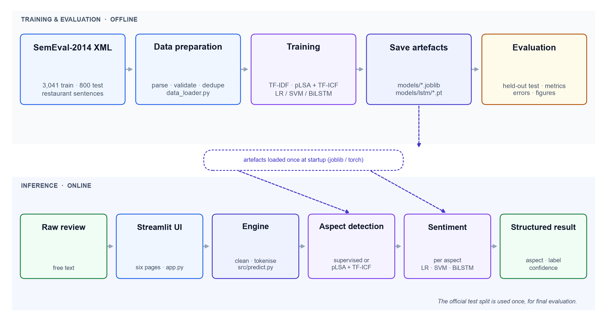
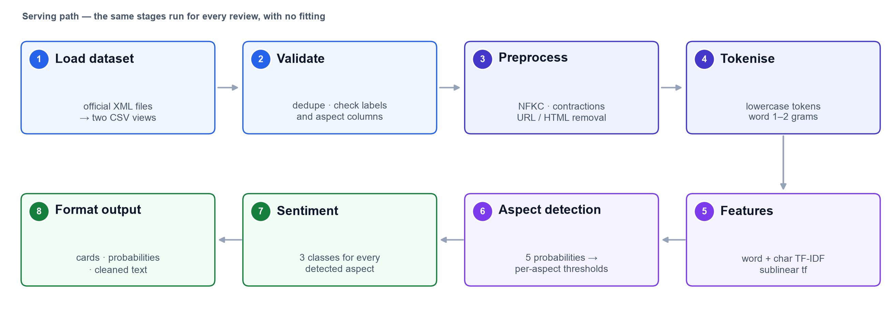
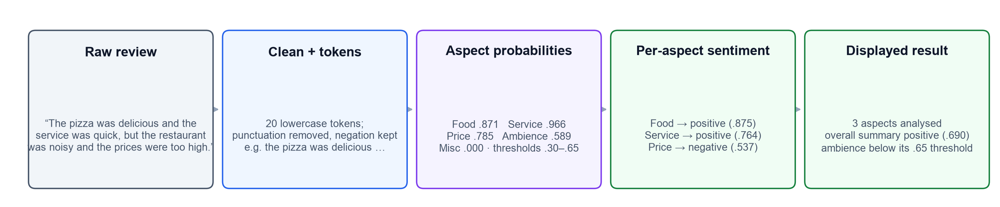
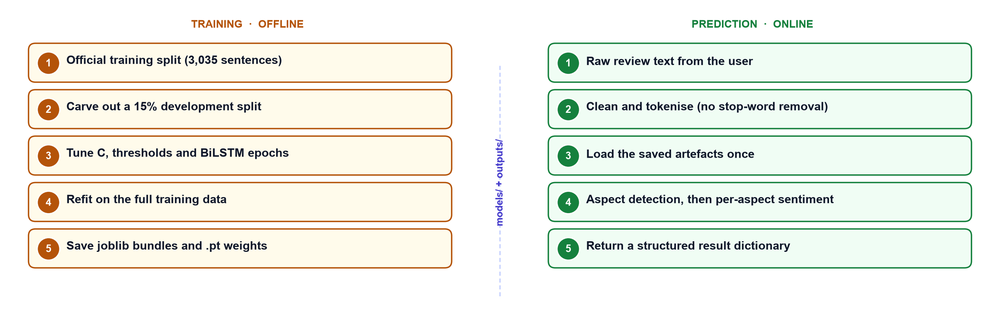
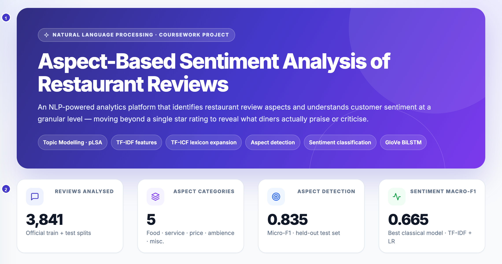
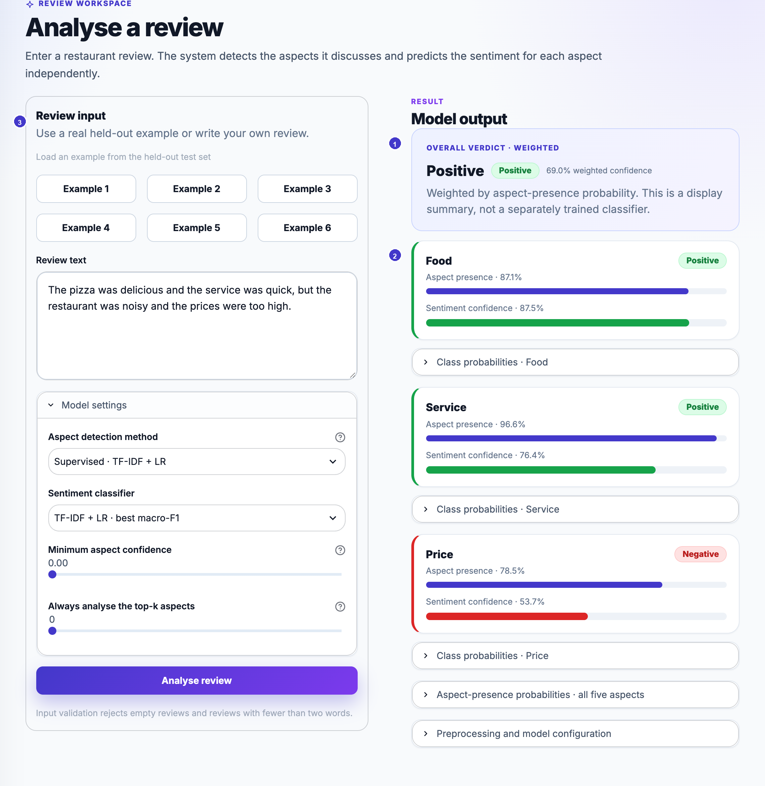
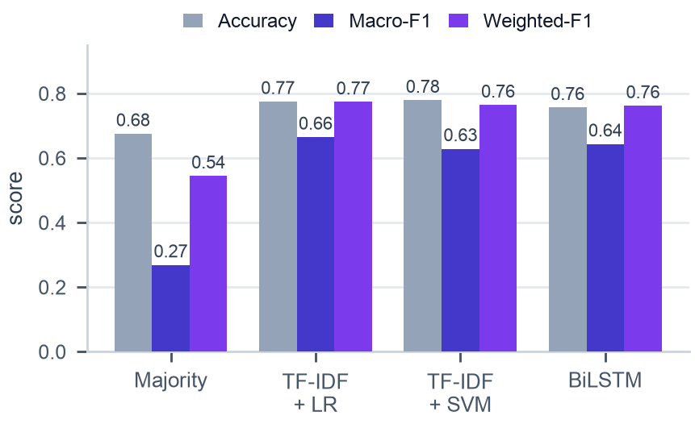
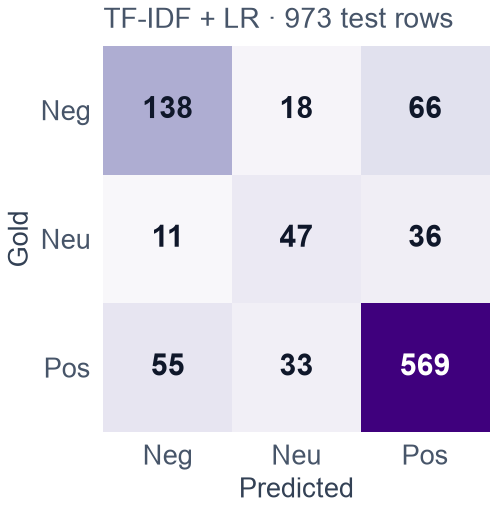
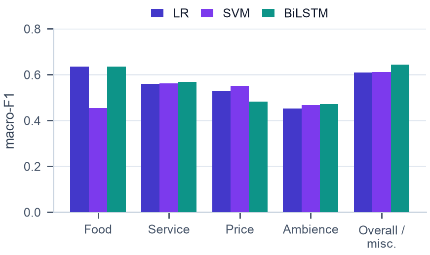
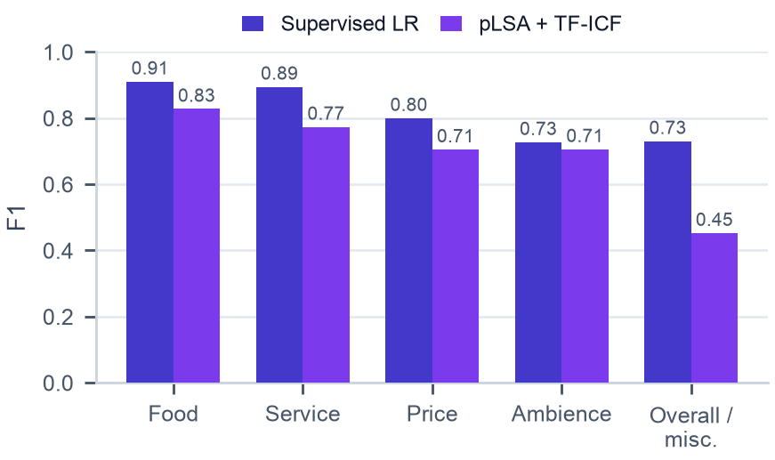

# Chapter 1 — Project Introduction

> **In one sentence.** ABSA Studio converts a free-text restaurant review into a set of aspect-level opinions: it detects which of five aspect categories the review discusses and predicts negative, neutral or positive sentiment for each one.

## 1.1 What ABSA Studio is

ABSA Studio is a complete, working NLP system rather than a single classifier. It contains:

- a reproducible pipeline that parses the official SemEval-2014 Task 4 restaurant XML into two validated tabular views;
- an **unsupervised** aspect-detection baseline built from 20 pLSA topics and a TF-ICF-expanded aspect lexicon;
- a **supervised** aspect detector that combines word and character TF-IDF features with one-vs-rest logistic regression;
- three per-aspect sentiment classifiers: TF-IDF + logistic regression, a calibrated linear SVM, and a GloVe-initialised BiLSTM;
- an evaluation suite that writes metrics, error tables, training curves and figures to `outputs/`;
- a six-page Streamlit interface that loads the saved artefacts and analyses a review in real time.

Every number shown in the interface is read from files produced by the training and evaluation scripts. Nothing is typed into the UI by hand.

## 1.2 What Aspect-Based Sentiment Analysis is

Traditional sentiment analysis assigns one label to a whole document. **Aspect-Based Sentiment Analysis (ABSA)** predicts sentiment toward specific aspects of an entity. For a review *r* and an aspect *a*, the system estimates the probability of each polarity *s*: **P(s | r, a)**.

> **Task illustration.** Review: “The food was excellent, but the staff were rude and the prices were too high.” A whole-review classifier might return *mixed* or *negative* and hide the praise. A correct ABSA system returns **Food → positive, Service → negative, Price → negative**. This example illustrates the task; Chapter 5 follows a verified prediction produced by the actual app.

The value is actionable granularity. A restaurant owner can keep the kitchen unchanged while fixing service and pricing. A single star rating cannot express that.

## 1.3 Motivation and problem statement

Star ratings collapse an entire visit into one number. A restaurant can serve excellent food while the service is slow and the prices are unfair. Reading thousands of reviews manually is not scalable, and keyword search cannot tell whether “expensive” is a complaint or a neutral factual statement.

The project therefore asks: **can a compact, reproducible NLP pipeline identify the aspects of a review and predict the polarity of each aspect independently, while remaining interpretable enough to explain in an academic setting?**

## 1.4 Objectives

1. Reproduce a standard ABSA benchmark faithfully, using the official train/test split.
2. Implement an interpretable unsupervised baseline (pLSA + TF-ICF) and compare it with supervised learning.
3. Build a strong aspect detector and three per-aspect sentiment classifiers.
4. Evaluate with metrics suited to multi-label and imbalanced classification.
5. Expose the trained models through an interactive interface with model selection, thresholds and confidence scores.
6. Keep the whole workflow reproducible, tested and documented.

## 1.5 What is implemented — and what is not

**Implemented:** five aspect categories; three polarity classes; sentence-level aspect detection; per-aspect sentiment; two detection methods; three sentiment models; a batch API; a six-page UI; saved artefacts; 19 automated tests.

**Not implemented (deliberately out of scope):** aspect-term extraction with character spans, document-level aggregation, sarcasm detection, multilingual input, transformer fine-tuning, user accounts or a deployed public API. These are discussed in Chapter 12.

> **Viva line.** “The contribution is the complete pipeline: from raw SemEval XML to a live interface, with an unsupervised topic-model baseline that makes the supervised model’s advantage measurable.”

# Chapter 2 — Fundamental NLP Concepts Used

Only concepts that appear in the repository are covered. The guide uses text classification, tokenisation, normalisation, stop-word removal and lemmatisation (pLSA only), n-grams, TF-IDF, topic modelling with pLSA, TF-ICF, aspect detection, sentiment classification, word embeddings and a BiLSTM. The sections below explain the four ideas that carry most of the technical weight.

## 2.1 Preprocessing and tokenisation

**What.** Preprocessing turns messy review text into a canonical form; tokenisation splits it into units. `clean_text` applies Unicode NFKC normalisation, lowercasing, HTML and URL removal, contraction expansion, and punctuation removal. Sentence-final exclamation marks become a token because emphasis carries sentiment.

**Why.** The same opinion appears as “wasn’t”, “was not” and “wasnt”. Contractions are expanded **before** punctuation removal so that negation survives: `wasn't → was not`. Negation is decisive for sentiment.

**In ABSA Studio.** Supervised models call `tokenize(text)` with stop-word removal **off** and lemmatisation **off**. Function words and negations carry sentiment. Topic modelling calls `tokenize(text, remove_stopwords=True, lemmatize=True)` because function words add noise to topics.

**Example.** “The pizza wasn’t bad!” becomes `the pizza was not bad !` — the negation and the emphasis are both preserved.

## 2.2 TF-IDF and n-grams

**What.** TF-IDF gives a word a high weight when it is frequent in one document but rare across the corpus:

$$ tfidf(t, d) = tf(t, d) × log( N / df(t) ) $$

**Why.** Words such as “the” appear everywhere and carry little information; “delicious” or “overpriced” are discriminative. Sublinear TF (`1 + log tf`) prevents one repeated word from dominating.

**How it is used.** `features.py` builds a `FeatureUnion` of two vectorisers: word 1–2 grams and character `char_wb` 3–5 grams, with `min_df=2`, character `max_features=60,000`, and sublinear TF. Word bigrams capture phrases such as “not good”; character n-grams make the model robust to morphology and spelling variation (“delicious”, “deliciously”, “delish”).

**Viva line.** “TF-IDF turns each review into a sparse vector where discriminative words and phrases have larger weights; I combine word bigrams for meaning with character n-grams for robustness.”

## 2.3 Topic modelling with pLSA

**What.** Probabilistic Latent Semantic Analysis models each document as a mixture of latent topics and each topic as a distribution over words. It learns **P(z | d)** and **P(w | z)** with Expectation–Maximisation.

**Why.** Reviews are unlabelled at the topic level. pLSA discovers recurring themes — food quality, staff, prices, atmosphere — without using aspect labels. That makes it a genuine unsupervised baseline and an interpretable window into the corpus.

**In ABSA Studio.** `plsa.py` fits 20 topics for 30 EM iterations over a vocabulary capped at 3,000 terms (`min_df=3`). The training script writes `models/plsa_model.joblib` and uses the topic-word distributions in lexicon induction. pLSA is **not** the final aspect classifier; it supplies structure that TF-ICF turns into an aspect lexicon.

## 2.4 TF-ICF and lexicon induction

**What.** Term Frequency–Inverse Cluster Frequency rewards terms that are frequent inside one topic cluster but rare in the others:

$$ tf-icf(t, c) = tf(t, c) × log( N / cf(t) ) $$

where *cf(t)* is the number of clusters containing term *t* and *N* is the number of clusters.

**Why.** A word such as “waiter” is frequent in the service cluster but absent from the food cluster; TF-ICF surfaces exactly this contrast. The top 30 terms per topic are aligned to five hand-written aspect seed lexicons by cosine similarity, and the best 60 expansion terms per aspect are stored in `models/aspect_lexicon.json`.

**In ABSA Studio.** The lexicon powers the unsupervised detector: a review’s score for an aspect is the normalised weight of its matched seed and expanded terms. It is transparent and needs no labels, but it cannot learn pragmatic cues such as “we will be back” without lexical overlap.

## 2.5 Word embeddings and the BiLSTM

**What.** Word embeddings map words to dense vectors so that similar words are close in space. A Bidirectional LSTM reads a sequence left-to-right and right-to-left, then combines both contexts.

**Why.** Sparse TF-IDF treats “delicious” and “tasty” as unrelated dimensions. Pre-trained GloVe vectors already encode similarity, and a BiLSTM can model word order and long-distance context such as negation.

**In ABSA Studio.** `lstm_model.py` loads GloVe 6B.50d vectors for the 4,120-token vocabulary; coverage is **92.38%**. Each aspect has its own BiLSTM: embedding 50 → bidirectional hidden 96 → masked mean and max pooling (384 features) → fully connected 128 + ReLU → 3 classes, with dropout 0.35. The model has about **369k parameters**.

**Honest result.** The BiLSTM reaches 0.756 accuracy and 0.643 macro-F1, slightly below TF-IDF + LR (0.775 / 0.665). With only 3,511 sentiment rows split across five aspects, the larger neural model overfits; this is analysed in Chapter 9.

## 2.6 What is *not* used

No stemming (lemmatisation is used only for pLSA), no Naive Bayes, no CRF, no BERT or other transformer, and no aspect-term sequence labeller. Stop-word removal and lemmatisation are deliberately excluded from the supervised models. Stating this clearly prevents over-claiming in a viva.

# Chapter 3 — Dataset Explanation

## 3.1 Source and purpose

The project uses the **SemEval-2014 Task 4 Aspect-Based Sentiment Analysis** dataset, restaurant domain (Pontiki et al., 2014). It is the standard academic benchmark for ABSA: each sentence is annotated with aspect categories and a polarity for each category, so it supports both aspect detection and aspect-specific sentiment classification.

The official XML files are stored in `data/raw/semeval2014/` and used unchanged. The only alteration is the removal of **six exact duplicate training texts**; the test split is untouched.

## 3.2 Two task views

`data_loader.py` parses the XML into two CSVs because the two tasks need different rows.

| View | File | Fields | Used for |
|---|---|---|---|
| Sentence view | `train_sentences.csv`, `test_sentences.csv` | `sentence_id`, `text`, `aspects`, `num_aspects`, five binary `aspect_*` columns | Multi-label aspect detection |
| Aspect–sentiment view | `train_aspect_sentiment.csv`, `test_aspect_sentiment.csv` | `sentence_id`, `text`, `aspect`, `label`, `label_id` | Per-aspect 3-class sentiment |

The sentence view has one row per review sentence. The aspect–sentiment view has one row per annotated (sentence, aspect) pair, so a sentence with three aspects appears three times.

## 3.3 Actual corpus statistics

| Statistic | Official train | Official test |
|---|---:|---:|
| Sentences | 3,041 | 800 |
| Duplicate texts removed | 6 | 0 |
| Unique sentences used | 3,035 | 800 |
| Aspect-category annotations | 3,713 | 1,025 |
| Aspect–sentiment rows after excluding `conflict` | 3,511 | 973 |
| Mean tokens per sentence | 13.83 | 14.03 |
| Longest sentence (tokens) | 69 | 58 |
| Sentences with 2+ aspects | 574 | 189 |

The training sentiment count is 3,511 because 3,713 annotations lose 195 `conflict` labels and 7 rows attached to the six duplicate sentences.

## 3.4 Labels and aspect categories

**Five aspects:** `food`, `service`, `price`, `ambience`, `miscellaneous` (the original `anecdotes/miscellaneous` category is mapped to `miscellaneous`).

**Three polarities:** `negative`, `neutral`, `positive`. The SemEval `conflict` label (195 training and 52 test annotations) is excluded because it is not a coherent sentiment class and would make the three-class task ambiguous.

| Aspect | Negative | Neutral | Positive |
|---|---:|---:|---:|
| Food | 209 | 90 | 867 |
| Service | 138 | 8 | 391 |
| Price | 100 | 21 | 183 |
| Ambience | 98 | 23 | 263 |
| Overall / misc. | 199 | 357 | 546 |

The imbalance is real: positive dominates, and neutral is rare for service. This is why **macro-F1** is the primary sentiment metric rather than accuracy.

## 3.5 Sample records from the test set

| Review | Aspect | Polarity |
|---|---|---|
| The bread is top notch as well. | Food | Positive |
| Meal was very expensive for what you get. | Price | Negative |
| The waiters ALWAYS look angry and even ignore their high-tipping regulars. | Service | Negative |
| The decor is designed in a contemporary Japanese style restaurant. | Ambience | Neutral |
| Bring your date and a bottle of wine! | Overall / misc. | Neutral |

## 3.6 Splits used for training and tuning

The official test set (800 sentences, 973 sentiment rows) is held out and used **once** for final evaluation. All model selection happens on a development split carved out of the official training set:

- **Aspect detector:** 3,035 unique sentences split randomly into 2,579 train / 456 dev.
- **Sentiment models:** for each aspect, an 85/15 stratified split of that aspect’s rows; the chosen configuration is then refitted on all rows for that aspect.
- **BiLSTM:** the same per-aspect dev split, with early stopping on dev macro-F1 and refitting at the best epoch.

This separation is the reason the reported test scores are credible: no test sentence influenced a threshold, a C value or an epoch.

## 3.7 Why this dataset, and what it limits

It provides human-annotated aspect categories and polarities, multiple aspects per sentence, and a standard test split, which makes results comparable with published work. Its limits are equally important: it is English, restaurant-specific, from 2014, and annotations are sentence-level rather than document-level. The model therefore learns restaurant vocabulary and cannot be assumed to transfer to hotels or laptops without retraining.

# Chapter 4 — Complete System Architecture

## 4.1 Architectural overview

The system has five layers. The diagram reflects the actual modules and artefact paths in the repository.



- **Data layer:** official XML, parsed and validated into `data/processed/`.
- **NLP layer:** normalisation, tokenisation, TF-IDF features, pLSA topics and TF-ICF lexicon.
- **Model layer:** aspect detector, per-aspect LR/SVM models, five BiLSTM classifiers.
- **Evaluation layer:** `evaluate.py`, `metrics.json`, `error_analysis.csv`, figures.
- **Serving layer:** `AspectSentimentEngine` + Streamlit UI.

## 4.2 Component responsibilities

`data_loader.py` parses the XML and builds both views; `preprocessing.py` normalises and tokenises; `features.py` builds the TF-IDF union; `plsa.py`, `tf_icf.py` and `aspect_lexicon.py` produce the unsupervised lexicon; `train.py` and `lstm_model.py` produce the artefacts; `predict.py` is the single inference API; `evaluate.py` writes the reports; and `app.py` plus `frontend/` render the six pages. Chapter 7 gives the module-by-module detail.

## 4.3 How data moves

**Offline.** XML → parsed sentences → two CSVs → TF-IDF matrices / pLSA documents → trained models → saved artefacts → test evaluation. The evaluation reads the saved models and the untouched test split.

**Online.** Review text → validation → cleaning and tokenisation → aspect probabilities → thresholding → per-aspect sentiment → result dictionary → cards and charts.

The key decision is that **training and serving share the same preprocessing and feature code**. `predict.py` loads the fitted vectorisers from the saved bundles, so the features seen at inference match those seen in training.

## 4.4 Frontend–backend contract

The UI is not a separate web service. Streamlit runs in the same Python process and calls:

```python
result = engine.predict(
    text,
    aspect_method="supervised", sentiment_model="tfidf_logreg",
)
```

The call also accepts optional `threshold` and `top_k` overrides. The returned dictionary contains the cleaned text, the aspect method and model used, per-aspect thresholds, aspect probabilities, detected aspects, a list of aspect results (sentiment, confidence, class probabilities), a `low_confidence` flag, and an overall display summary. The UI only formats this dictionary; it contains no prediction logic.

> **Viva line.** “The architecture separates offline learning from online inference. The app never trains; it loads joblib and PyTorch artefacts and calls one engine method.”

# Chapter 5 — Step-by-Step Working of the NLP Pipeline

## 5.1 The serving pipeline



## 5.2 Stage-by-stage explanation

| # | Stage | What happens | Module / function | Input → output |
|---|---|---|---|---|
| 1 | Load dataset | XML parsed; two CSV views built | `data_loader.parse_semeval_xml`, `build_*_frame` | XML → DataFrames |
| 2 | Validate | Empty text, duplicates, invalid aspects/labels checked | `validate_frame`, `prepare_data` | DataFrames → clean CSVs |
| 3 | Preprocess | NFKC, lowercase, HTML/URL removal, contraction expansion, punctuation | `preprocessing.clean_text` | Raw text → cleaned text |
| 4 | Tokenise | Whitespace tokens; optional stop-word removal/lemma | `preprocessing.tokenize` | Cleaned text → token list |
| 5 | Features | Word 1–2 gram + char 3–5 gram TF-IDF | `features.build_vectorizer` | Text → sparse vector |
| 6 | Aspect detection | Five probabilities; tuned per-aspect thresholds applied | `predict.detect_aspects`, `_detected` | Vector → aspects |
| 7 | Sentiment | One 3-class prediction per detected aspect | `predict.predict_sentiment` | (text, aspect) → label + probabilities |
| 8 | Format | Cards, confidence bars, probability tables, cleaned text | `app.py` + `frontend/components.py` | Result dict → UI |

At **training time**, stages 3–5 are fitted on the training split, stage 6 is trained with a dev split for threshold tuning, and stage 7 trains one model per aspect. At **prediction time**, nothing is fitted: the saved vectorisers transform the new text and the saved classifiers return probabilities.

## 5.3 Worked example with real numbers

The app’s default review is:

> “The pizza was delicious and the service was quick, but the restaurant was noisy and the prices were too high.”



**Step 1 — Clean.** `clean_text` lowercases the sentence and removes punctuation, producing 20 tokens. No stop words are removed and negation is retained, because the supervised models need function words.

**Step 2 — Aspect probabilities.** The supervised detector returns:

| Aspect | Probability | Tuned threshold | Detected? |
|---|---:|---:|---|
| Food | 0.871 | 0.40 | Yes |
| Service | 0.966 | 0.50 | Yes |
| Price | 0.785 | 0.30 | Yes |
| Ambience | 0.589 | 0.65 | No |
| Overall / misc. | 0.000 | 0.35 | No |

**Step 3 — Sentiment.** Each detected aspect is classified independently:

| Aspect | Prediction | Confidence | Negative | Neutral | Positive |
|---|---|---:|---:|---:|---:|
| Food | positive | 0.875 | 0.115 | 0.009 | 0.875 |
| Service | positive | 0.764 | 0.180 | 0.056 | 0.764 |
| Price | negative | 0.537 | 0.537 | 0.071 | 0.392 |

**Step 4 — Display.** The UI shows three aspect cards and an overall summary of *positive* with 0.690 weighted confidence. Ambience is **not** shown because its probability (0.589) falls below its stricter tuned threshold (0.65). This is an important, honest behaviour: the “noisy” clause is recognised as ambience-related but not confidently enough to pass the threshold. The app exposes the threshold slider and the full probability table so the user can inspect this.

## 5.4 Training versus prediction



Training fits vectorisers, classifiers, thresholds and BiLSTM weights on 3,035 sentences; prediction fits nothing and uses one unseen review. Labels and the test set are required only during training and final evaluation.

## 5.5 Edge cases and guards

- Reviews with fewer than two tokens are rejected with a clear warning (`is_valid_text`).
- If no aspect passes its threshold, the engine still returns the single most probable aspect and sets `low_confidence=True`; the UI displays a warning.
- The UI slider is a **floor**: the effective threshold is `max(tuned_threshold, user_threshold)`, so the user can make detection stricter but cannot silently weaken the tuned model.
- `top_k` forces the *k* most probable aspects to be analysed even if they fall below threshold, which is useful for exploratory analysis.
- Batch prediction is available through `predict_batch`, although the UI currently analyses one review at a time.

# Chapter 6 — Algorithms and Model Explanation

## 6.1 Algorithm map

| Algorithm | Role | Input | Output | Why chosen |
|---|---|---|---|---|
| TF-IDF | Text representation | Clean text | Sparse vector | Strong, fast, interpretable baseline |
| Logistic regression | Aspect detection (one-vs-rest) and sentiment | TF-IDF vector | Probabilities | Linear, calibrated, handles sparse text |
| Linear SVM | Alternative sentiment classifier | TF-IDF vector | Calibrated probabilities | Strong margin-based baseline |
| pLSA + EM | Unsupervised topic discovery | Tokenised documents | Topic–word and document–topic distributions | Interpretable, no labels |
| TF-ICF | Cluster-specific term weighting | Topic clusters | Ranked terms | Turns topics into an aspect lexicon |
| BiLSTM | Neural sentiment classifier | Token IDs + GloVe | 3-class probabilities | Captures order and context |
| Majority class | Lower-bound baseline | Training labels | Most frequent label | Shows why accuracy alone is misleading |

## 6.2 Logistic regression

For a feature vector **x**, logistic regression learns a weight vector **w** and bias *b*. The probability of class *k* is:

$$ P(y = k | x) = exp(w_k · x + b_k) / Σ_j exp(w_j · x + b_j) $$

**Aspect detection.** Five binary problems are trained with `OneVsRestClassifier`: one classifier asks “is food present?”, another asks “is service present?”, and so on. `C=4.0` was selected from `{1, 4, 10}` on the dev split; `liblinear` is used with balanced class weights because aspects are imbalanced. Per-aspect thresholds are then tuned on dev probabilities to trade precision against recall.

**Sentiment.** One multinomial model is trained **per aspect** on that aspect’s rows. The same vectoriser design is used. Logistic regression is a good fit because the feature space is high-dimensional and sparse, the dataset is small, and the coefficients are inspectable.

## 6.3 Linear SVM with calibration

A linear SVM learns a maximum-margin boundary with hinge loss. It often generalises well on sparse text, but its raw decision values are not probabilities. `CalibratedClassifierCV` with sigmoid calibration over three folds converts them into probabilities so the UI can display confidence. The SVM has the highest accuracy (0.779) but a lower macro-F1 (0.629) because it trades neutral recall for positive recall.

## 6.4 pLSA and TF-ICF

pLSA represents a document as a mixture over *Z* topics and a topic as a distribution over words:

$$ P(w | d) = Σ_z P(w | z) P(z | d) $$

EM alternates between estimating the posterior topic responsibility of each word occurrence (E-step) and re-estimating the two distributions (M-step). The implementation works only on non-zero document-term entries, which keeps 30 iterations fast on a few thousand short reviews.

After fitting, documents are assigned to their dominant topic. TF-ICF scores terms inside each cluster; the top 30 terms per topic are compared with five seed lexicons using cosine similarity, and the strongest 60 terms per aspect are added to the lexicon. The result is a human-readable JSON file, not a black box.

## 6.5 BiLSTM

The BiLSTM reads the token sequence in both directions. At each position it produces a forward and a backward hidden state; concatenating them gives a representation that depends on both preceding and following words. The model pools these states with a **masked mean** and a **masked max**, concatenates the two (384 features), passes them through a 128-unit ReLU layer and a 3-class output layer.

Training uses class-weighted cross-entropy to counter the positive/neutral imbalance, Adam with learning rate 1e-3, batch size 32, dropout 0.35, up to 18 epochs and early stopping with patience 3. The best epoch is then used to refit on the full aspect data. This is why the BiLSTM is a genuine neural baseline rather than a token gesture.

## 6.6 Design rationale

The project deliberately pairs a **transparent unsupervised** method with **strong supervised** methods. pLSA + TF-ICF shows what can be learned without labels and provides interpretable topics; TF-IDF + LR provides a robust, fast benchmark; the BiLSTM tests whether pre-trained embeddings and sequence modelling help. On this dataset they do not beat the linear model, and reporting that result honestly is part of the contribution.

# Chapter 7 — Source Code and Module-by-Module Explanation

## 7.1 Module map

| File / module | Responsibility | Why it is required |
|---|---|---|
| `src/config.py` | Paths, aspects, labels, seeds, hyper-parameters | One source of truth |
| `src/data_loader.py` | XML parsing, two views, validation, dedupe | Reproducible dataset |
| `src/preprocessing.py` | Normalisation, contractions, tokenisation, validity check | Consistent text handling |
| `src/features.py` | Word + character TF-IDF union, writable CSR helper | Shared representation |
| `src/plsa.py`, `src/tf_icf.py`, `src/aspect_lexicon.py` | pLSA EM, TF-ICF scoring, seed alignment, lexicon detector | Unsupervised baseline |
| `src/lstm_model.py` | Vocabulary, dataset, `SentimentLSTM`, GloVe, training loop | Neural classifier |
| `src/train.py` | Dev splits, detector training, sentiment training, orchestration | Produces every artefact |
| `src/predict.py` | `AspectSentimentEngine`, batch prediction, validation | Single inference API |
| `src/evaluate.py`, `src/plots.py` | Test metrics, per-class/aspect reports, error analysis, figures | Trustworthy evaluation |
| `scripts/*.py` | Prepare data, train all, evaluate all, regenerate figures | Reproducible entry points |
| `app.py`, `frontend/` | Six-page Streamlit application and CSS/HTML design system | User-facing presentation |

## 7.2 Execution flow

**Training.** `python -m scripts.train_all` ensures the processed data exists, then calls `build_lexicon_artifacts`, `train_aspect_detector`, `train_sentiment_models` and `train_lstm_models`. Each writes to `models/` and a summary to `outputs/reports/training_summary.json`.

**Evaluation.** `python -m scripts.evaluate_all` loads the saved artefacts, scores the official test split, writes `metrics.json`, `classification_report.txt`, `error_analysis.csv` and the figures.

**Serving.** `streamlit run app.py` loads the engine once via `st.cache_resource`; metrics, statistics and test samples are cached with `st.cache_data`. Every rerun therefore reuses the same models instead of reloading them.

## 7.3 The core inference logic

The threshold rule is small but central:

```python
for aspect in ASPECTS:
    if probabilities[aspect] >= effective_thresholds[aspect]:
        detected.append(aspect)
```

`effective_thresholds` comes from the tuned bundle, optionally raised by the UI slider. If no aspect passes, `predict` falls back to the single highest-probability aspect and marks the result `low_confidence`.

## 7.4 Configuration and artefacts

All paths and hyper-parameters live in `src/config.py`: five aspects, three labels, TF-IDF settings, pLSA settings, BiLSTM dimensions, seed 42 and the dev fraction 0.15. Artefacts are separated by type (`models/*.joblib`, `models/lstm/*.pt`, `models/lstm/meta.json`, `models/sentiment_metadata.json`), so the UI can list available sentiment models dynamically.

## 7.5 Tests

`tests/test_pipeline.py` contains **19 passing tests**: XML parsing, view construction, duplicate handling, preprocessing (including negation), pLSA shape, TF-ICF behaviour, metric calculations, artefact existence, engine predictions and a Streamlit `AppTest` smoke test. `pytest -q` is the quickest way to prove the repository is healthy during a demo.

# Chapter 8 — Frontend and User Interface Working

## 8.1 Technology and design

The interface is a Streamlit application with custom HTML/SVG components (`frontend/components.py`) and a CSS design system (`frontend/styles.py`). It uses Inter typography, an indigo/purple palette, white cards, soft shadows and responsive breakpoints. It is not a separate JavaScript front end: Streamlit renders Python on each interaction, and `st.session_state` preserves the current review and result.

The app has **six pages** selected from the sidebar. `st.cache_resource` keeps the inference engine in memory; `st.cache_data` caches metrics, statistics and sample rows.

## 8.2 Page-by-page purpose

| Page | Purpose | What it displays | Backend source |
|---|---|---|---|
| Overview | Frame the project and prove it works | Hero, four KPI cards, problem/solution, pipeline, capabilities, quick demo | `metrics.json`, engine |
| Analyse Review | Full ABSA workspace | Input, examples, model settings, thresholds, per-aspect cards, probabilities | `AspectSentimentEngine` |
| Model Performance | Evidence of quality | Best-model KPIs, comparison table, charts, error analysis | `metrics.json`, figures, `error_analysis.csv` |
| Dataset | Data provenance and statistics | Split KPIs, task views, corpus statistics, distributions, samples, preprocessing | `dataset_stats.json`, test CSVs |
| Methodology | Explain the method | Workflow timeline, equations, model configuration, evaluation protocol | Static content + artefacts |
| About | Context and reflection | Objectives, stack, limitations, future work, references | Static content |

## 8.3 The user journey

1. The user opens the app; the Overview page loads metrics from disk.
2. They select **Analyse Review**, press an example button (a real held-out sentence) or type a review, choose the model and optional threshold floor, then press **Analyse review**.
3. Streamlit calls `engine.predict` and stores the result in session state; the right column renders the verdict, one card per detected aspect, class probabilities, the five-aspect table and the cleaned text.
4. They switch to **Model Performance** for test metrics, or to **Dataset** and **Methodology** to explain the data and design.

## 8.4 Frontend–backend interaction

There is no REST API and no network boundary between UI and model. Streamlit calls `AspectSentimentEngine.predict` in the same process. This simplifies the prototype and removes serialisation overhead, but it also means the app must run in the same environment as the model dependencies. For a coursework demo this is an advantage: one command starts everything.

## 8.5 Responsiveness and usability

The layout was checked at desktop, laptop, tablet and mobile widths; the sidebar collapses on small screens and the main content avoids horizontal overflow. Long tables use a dedicated wrapper, and colour is never the only signal: sentiment is always written as a word and accompanied by a confidence bar.

## 8.6 Annotated screenshots

{width=74%}

{width=74%}

Figure 8.2 is the most important screen for a demonstration. The overall verdict is explicitly labelled *weighted* and marked as a display summary, not a separately trained classifier. The per-aspect cards show two different quantities: **aspect presence** (did the detector find this aspect?) and **sentiment confidence** (how sure is the classifier about the polarity?). Confusing these two is a common viva trap.

# Chapter 9 — Model Training and Performance Evaluation

## 9.1 Evaluation protocol

The official test split (800 sentences, 973 aspect–sentiment rows) is used only after all tuning is complete. Aspect detection is evaluated as **multi-label** classification over five aspects; sentiment is evaluated as **3-class classification** over the 973 aspect-specific rows. The majority-class baseline is included to show why accuracy is not sufficient.

## 9.2 Metrics used

| Metric | Formula | Interpretation |
|---|---|---|
| Accuracy | correct / total | Overall hit rate; misleading under imbalance |
| Precision | TP / (TP + FP) | Of the predicted positives, how many were right? |
| Recall | TP / (TP + FN) | Of the true positives, how many were found? |
| F1 | 2PR / (P + R) | Harmonic mean of precision and recall |
| Macro-F1 | mean of per-class F1 | Treats each class equally; exposes neutral failures |
| Weighted-F1 | support-weighted mean F1 | Reflects overall performance but hides rare classes |
| Hamming loss | fraction of wrong aspect labels | Multi-label error rate |
| Subset accuracy | exact match of all five labels | Strict multi-label accuracy |

## 9.3 Sentiment results

| Model | Accuracy | Macro-F1 | Weighted-F1 |
|---|---:|---:|---:|
| Majority class | 0.6752 | 0.2687 | 0.5443 |
| **TF-IDF + LR** | **0.7749** | **0.6648** | **0.7737** |
| TF-IDF + SVM | 0.7790 | 0.6287 | 0.7641 |
| BiLSTM | 0.7564 | 0.6433 | 0.7620 |

**Best model by macro-F1: TF-IDF + LR.** The SVM has slightly higher accuracy but a much lower macro-F1 because it predicts neutral poorly. The BiLSTM beats the majority baseline comfortably but does not beat the linear model.

| LR class | Precision | Recall | F1 | Support |
|---|---:|---:|---:|---:|
| Negative | 0.676 | 0.622 | 0.648 | 222 |
| Neutral | 0.480 | 0.500 | 0.490 | 94 |
| Positive | 0.848 | 0.866 | 0.857 | 657 |

The positive class is easy; neutral is hard because it is rare and semantically close to both extremes (“the decor is contemporary” is neither praise nor criticism). Negative recall suffers because some complaints are expressed indirectly. The next two sections report aspect detection and visualise all results.

## 9.4 Aspect detection results

| Detector | Micro-F1 | Macro-F1 | Hamming loss | Subset accuracy |
|---|---:|---:|---:|---:|
| TF-IDF + one-vs-rest LR | **0.8351** | **0.8126** | **0.0860** | **0.6875** |
| pLSA + TF-ICF lexicon | 0.6517 | 0.6930 | 0.2245 | 0.2038 |

| Aspect | Supervised precision | Supervised recall | Supervised F1 | Lexicon F1 |
|---|---:|---:|---:|---:|
| Food | 0.909 | 0.911 | 0.910 | 0.828 |
| Service | 0.900 | 0.890 | 0.895 | 0.773 |
| Price | 0.761 | 0.843 | 0.800 | 0.705 |
| Ambience | 0.835 | 0.644 | 0.727 | 0.706 |
| Overall / misc. | 0.661 | 0.816 | 0.730 | 0.453 |

The supervised detector gains about 12 macro-F1 points over the unsupervised baseline. The largest gap is miscellaneous: the lexicon over-predicts it (recall 1.0, precision 0.29) because broad seed terms match many reviews, while the supervised model learns which contexts actually imply an overall judgement.

## 9.5 Visual comparison

:::cols




:::

## 9.6 Interpreting the results

- **Why LR wins.** Sparse lexical features with balanced weights generalise well on 3.5k rows. The BiLSTM has ~369k parameters and fewer than 1,200 training rows for some aspects, so it overfits.
- **Neutral is the bottleneck.** All models struggle; the LR neutral F1 is 0.49, and most neutral errors become positive. This drags down macro-F1 even when accuracy looks respectable.
- **Accuracy vs macro-F1.** The SVM’s higher accuracy comes from predicting the majority positive class more aggressively; macro-F1 exposes the cost.
- **Aspect detection is easier than sentiment.** Detecting “food” is a lexical cue problem; deciding whether a food comment is neutral or mildly positive is subtler.
- **Thresholds matter.** Ambience in the default example is a concrete case: the signal is present (0.589) but below the tuned 0.65 threshold. The app makes this inspectable instead of hiding it.

# Chapter 10 — Complete Practical Demonstration Guide

## 10.1 Before the demo

```bash
cd NLP_PROJ
source .venv/bin/activate
streamlit run app.py
```

Open `http://localhost:8501`. Confirm that the Overview KPIs show 3,841 reviews, 5 aspects, 0.835 aspect micro-F1 and 0.665 sentiment macro-F1. Keep a terminal ready with `pytest -q` in case the professor asks whether the project is tested.

## 10.2 Five-step demonstration flow

| Step | Action | What to say |
|---|---|---|
| 1 | Show the Overview and KPIs | “This is an end-to-end ABSA system, not just a classifier. The KPIs come from the real evaluation report.” |
| 2 | Open Analyse Review and keep the default review | “This review contains food, service, ambience and price opinions; nothing is retrained here.” |
| 3 | Press Analyse review, read the verdict and cards | “The engine cleans the text, computes five aspect probabilities, applies tuned thresholds, then classifies each detected aspect. The overall verdict is a weighted display summary.” |
| 4 | Point out ambience, then switch to BiLSTM | “Ambience scored 0.589 but its threshold is 0.65, so it is not shown. The neural model gives similar labels but different confidence.” |
| 5 | Open Model Performance, then Dataset | “These are the test metrics and the data behind them; the test split was never used for tuning.” |

## 10.3 A 3–5 minute script

> “My project is ABSA Studio. It performs aspect-based sentiment analysis on restaurant reviews. Instead of giving one label to a whole review, it identifies which aspects the review talks about — food, service, price, ambience and overall experience — and predicts sentiment for each one separately.
>
> The dataset is the official SemEval-2014 Task 4 restaurant benchmark: 3,041 training sentences and 800 test sentences, with human annotations for aspect categories and polarity. I removed six duplicate training texts, excluded the `conflict` label, and kept the official test split untouched until the final evaluation. Offline, I parse the XML into two views, clean and tokenise the text, build word and character TF-IDF features, and train the models. Online, the Streamlit app loads those saved artefacts and analyses a new review in one call.
>
> For aspect detection I compare two approaches. The unsupervised one uses pLSA to discover 20 latent topics, then TF-ICF to find terms specific to each topic, and aligns them with aspect seed lexicons. The supervised one uses one-vs-rest logistic regression on TF-IDF features with tuned per-aspect thresholds. It reaches 0.835 micro-F1, against 0.652 for the lexicon baseline, so labels clearly help.
>
> For sentiment I trained three classifiers per aspect: logistic regression, a calibrated linear SVM, and a GloVe-initialised BiLSTM. Logistic regression is best by macro-F1 at 0.665; the SVM has slightly higher accuracy but worse neutral recall, and the BiLSTM does not beat the linear model because the dataset is small.
>
> In the live demo, the review mentions pizza, service, noise and prices. The system detects food, service and price: food and service are positive, price is negative. Ambience is not shown because its probability is below its tuned threshold; I expose that probability so the behaviour is transparent. The main limitation is sentence-level, restaurant-specific ABSA without aspect-term extraction or sarcasm handling. Future work would fine-tune a transformer and add term extraction. The current system is complete, reproducible, tested and honest about its errors.”

## 10.4 Contingency notes

- If the app is slow on first load, explain that the engine loads five BiLSTM checkpoints and joblib bundles once; later predictions are fast.
- If a prediction looks wrong, do not hide it. Point to the confidence and the confusion matrix, and explain the likely cause (implicit opinion, sarcasm, neutral ambiguity).
- If asked to prove the numbers, open `outputs/reports/metrics.json` or run `pytest -q`.

# Chapter 11 — Viva and Professor Question Preparation

## Basic questions

**Q1. What is NLP?** Natural Language Processing builds methods for computers to analyse and generate human language. This project uses NLP for text classification: turning review text into aspect and sentiment labels.

**Q2. What is ABSA?** Aspect-Based Sentiment Analysis predicts sentiment toward specific aspects of an entity rather than one label for the whole text. Here, each review is mapped to zero or more of five aspects, and each detected aspect gets negative, neutral or positive.

**Q3. What problem does your project solve?** It makes review analysis granular and actionable. A restaurant can see that food is praised while service and price are criticised, instead of receiving a single star rating that hides the reason.

**Q4. What is the difference between sentiment analysis and ABSA?** Traditional sentiment analysis returns one polarity for the whole document. ABSA returns one polarity per aspect and must also decide which aspects are present, so it combines multi-label detection with multi-class classification.

**Q5. Why are star ratings insufficient?** They collapse different opinions into one number. A three-star review may contain excellent food and terrible service; the rating cannot tell an owner what to fix.

## Dataset questions

**Q6. Which dataset did you use?** SemEval-2014 Task 4, restaurant domain: 3,041 official training sentences and 800 official test sentences, with aspect-category and polarity annotations.

**Q7. Why did you choose it?** It is the standard ABSA benchmark, with human aspect-level labels, multiple aspects per sentence and an official split that makes results comparable.

**Q8. What are its important columns?** The sentence view has `text`, five binary aspect columns and `num_aspects`. The aspect–sentiment view has `text`, `aspect`, `label` and `label_id`, one row per annotated aspect.

**Q9. How did you divide training and testing data?** I kept the official 800-sentence test split untouched. From the 3,035 unique training sentences I carved out 456 for development (15%) to tune thresholds and hyper-parameters; sentiment models use a stratified 85/15 split per aspect. Final test evaluation happens once.

## Technical questions

**Q10. What is TF-IDF?** It weights a term by how often it occurs in a document and how rare it is across documents: `tf × log(N/df)`. Frequent but uninformative words get low weights; discriminative words get high weights. I use sublinear TF and combine word 1–2 grams with character 3–5 grams.

**Q11. Why is preprocessing required?** Reviews contain inconsistent casing, HTML, URLs, contractions and punctuation. Normalising them reduces sparsity and keeps training and inference consistent. Contractions are expanded before punctuation removal so negation survives.

**Q12. Why don’t you remove stop words for the supervised models?** Words like “not”, “but” and “very” carry sentiment and contrast. Removing them would destroy negation and clause boundaries. Stop-word removal and lemmatisation are used only for pLSA, where function words add noise to topics.

**Q13. What is topic modelling?** It discovers latent themes in a corpus without labels. pLSA represents each document as a mixture of topics and each topic as a distribution over words. I use 20 topics to induce an aspect lexicon.

**Q14. What is the role of aspect detection?** It decides which aspects are present before sentiment is predicted. Without it, the system would have to classify sentiment for all five aspects even when the review only discusses food.

**Q15. How does logistic regression work?** It learns a linear weight for each feature and converts the score into a probability with the softmax (or sigmoid) function. For aspect detection I train five one-vs-rest classifiers; for sentiment I train one multinomial classifier per aspect.

**Q16. Why might a BiLSTM be useful?** It reads the sequence in both directions and can model word order and context, such as negation or a sentiment word appearing after the aspect. GloVe initialisation gives it meaningful word vectors from the start.

**Q17. What is the difference between precision and recall?** Precision is the fraction of predicted positives that are correct; recall is the fraction of true positives that were found. F1 balances them. In aspect detection, low precision means false alarms; low recall means missed aspects.

**Q18. Why macro-F1 instead of accuracy?** Macro-F1 averages per-class F1, so the rare neutral class counts as much as the dominant positive class. Accuracy can look high while the model ignores neutral entirely, as the majority baseline shows.

## Implementation questions

**Q19. Explain your complete system architecture.** Data loading produces two views; preprocessing and TF-IDF create features; pLSA + TF-ICF build the unsupervised lexicon; supervised training produces the detector and per-aspect sentiment models; evaluation writes metrics; the Streamlit app loads the artefacts and calls `AspectSentimentEngine.predict`.

**Q20. How does a review pass through your NLP pipeline?** It is validated, cleaned, tokenised, vectorised, scored for five aspects, thresholded, classified per detected aspect, and formatted into cards and probability tables.

**Q21. How does the frontend communicate with the backend?** There is no HTTP API. Streamlit runs in the same process and calls the engine directly. The engine is cached with `st.cache_resource`; metrics and datasets use `st.cache_data`.

**Q22. How are predictions generated?** The saved vectoriser transforms the text; the aspect classifier returns five probabilities; tuned thresholds decide presence; the saved per-aspect sentiment model returns three probabilities; the maximum is the label and its value is the confidence.

**Q23. How are the models evaluated?** Aspect detection uses micro-F1, macro-F1, Hamming loss and subset accuracy. Sentiment uses accuracy, macro-F1, weighted-F1, per-class precision/recall/F1 and a confusion matrix. All scores come from the official test split.

**Q24. What happens when the user enters a new review?** It is cleaned with the same functions used in training, transformed by the fitted vectorisers, and scored by the saved models. The result is stored in session state and rendered. No fitting or file writing occurs.

## Critical-thinking questions

**Q25. What are the limitations of your project?** It is sentence-level, English and restaurant-specific; it detects categories but not aspect-term spans; neutral recall is low; sarcasm and implicit opinions are not modelled; the BiLSTM overfits the small dataset; and the app is a local prototype rather than a deployed service.

**Q26. What happens with sarcasm?** There is no sarcasm-specific component. Negation and contrast are preserved by preprocessing and n-grams, but sarcasm often reverses the literal polarity and would be misclassified. Detecting it would require pragmatic features or a transformer trained on sarcastic text.

**Q27. How could performance be improved?** Fine-tune a transformer such as RoBERTa, add BIO/CRF aspect-term extraction, collect more neutral and negative examples, calibrate thresholds per domain, and ensemble lexical and neural models.

**Q28. What would happen with a completely new domain?** The five aspects and the learned vocabulary are restaurant-specific. A hotel review about “room” and “location” would map poorly onto food/service/price/ambience. The pipeline could be reused, but the models and aspect schema would need retraining or domain adaptation.

**Q29. Why is your approach better than simple overall sentiment classification?** It preserves mixed opinions. A review with excellent food and rude staff is not forced into one label; the system reports both signals separately, which is more useful for decisions and more faithful to the text.

**Q30. Why include the weaker pLSA baseline?** It demonstrates what topic modelling can learn without labels and makes the value of supervision measurable. The supervised detector gains about 12 macro-F1 points, but the lexicon is interpretable and provides a qualitative view of the topics.

# Chapter 12 — Limitations and Future Enhancements

## 12.1 Current limitations

| Area | Limitation | Consequence |
|---|---|---|
| Data | 3,035 training sentences, 3,511 sentiment rows | Small for neural models; overfitting |
| Domain | English restaurant reviews from 2014 | Poor transfer to other domains/languages |
| Granularity | Sentence-level, category-level | No aspect-term spans; no document aggregation |
| Labels | `conflict` excluded | Some genuinely mixed annotations are dropped |
| Neutral class | Rare and semantically subtle | Low neutral F1 for every model |
| Pragmatics | No sarcasm, humour or implicit opinion modelling | Literal models can invert meaning |
| Deployment | Local Streamlit prototype | No authentication, monitoring or public API |

## 12.2 Model-specific limitations

The supervised detector misses aspects expressed indirectly (“we will be back” implies a positive overall experience), and thresholds tuned on one dev split may not transfer. The BiLSTM has ~369k parameters and overfits after a few epochs. The lexicon baseline over-predicts miscellaneous because its seed terms are broad.

## 12.3 Prediction limitations

The UI shows only aspects that pass their thresholds; when none pass, it shows the top aspect with a low-confidence warning. The overall verdict is a weighted display summary, not a calibrated document-level classifier. Confidence is a model probability, not a guarantee of correctness.

## 12.4 Future enhancements

1. **Transformer fine-tuning.** Fine-tune RoBERTa or DeBERTa on (review, aspect) pairs and compare with the current baselines.
2. **Aspect-term extraction.** Add a BIO/CRF tagger to extract the exact phrase and span, not just the category.
3. **Cross-domain and multilingual evaluation.** Test on hotel/laptop and non-English reviews to quantify transfer.
4. **Better neutral handling.** Collect or synthesise neutral examples, use ordinal loss, or calibrate class thresholds.
5. **Document-level aggregation.** Combine sentence predictions into a review-level aspect summary.
6. **Deployment and explainability.** Wrap the engine in FastAPI with logging, and surface influential n-grams per prediction.

## 12.5 One-page revision card

> **Dataset:** SemEval-2014 Task 4 restaurant; 3,041 train / 800 test; 5 aspects; 3 labels; `conflict` excluded.
> **Features:** word 1–2 gram + char 3–5 gram TF-IDF; `min_df=2`; char max 60k; sublinear TF.
> **Aspect detection:** one-vs-rest LR, `C=4.0`, tuned thresholds; test micro-F1 **0.835**, macro-F1 **0.813**.
> **Unsupervised baseline:** 20 pLSA topics, 30 EM iterations, TF-ICF top 30 terms/topic, 60 expansion terms/aspect; micro-F1 **0.652**.
> **Sentiment:** per-aspect LR / calibrated SVM / BiLSTM; best macro-F1 **0.665** (LR), accuracy **0.775**.
> **BiLSTM:** GloVe 6B.50d, 92.38% coverage, hidden 96, mean+max pooling, 369k parameters.
> **Inference:** clean → vectorise → 5 aspect probabilities → thresholds → 3-class sentiment per aspect → result dict.
> **UI:** six Streamlit pages; engine cached once; no retraining; per-aspect confidence and thresholds exposed.
> **Limitations:** sentence-level, restaurant-only, neutral recall, sarcasm, no aspect-term spans.
> **Future:** transformer fine-tuning, term extraction, cross-domain data, deployment.
